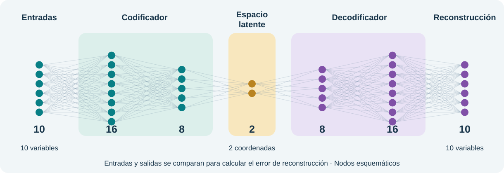
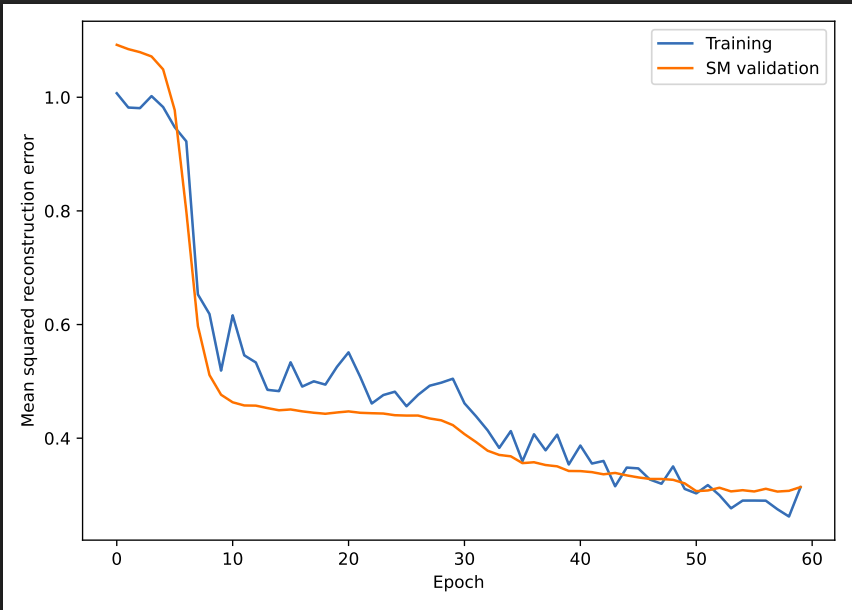
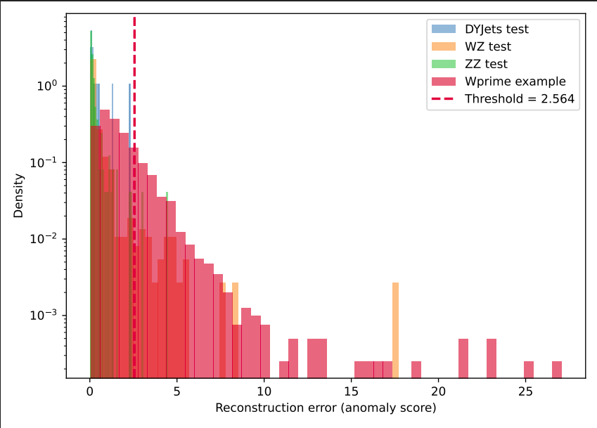
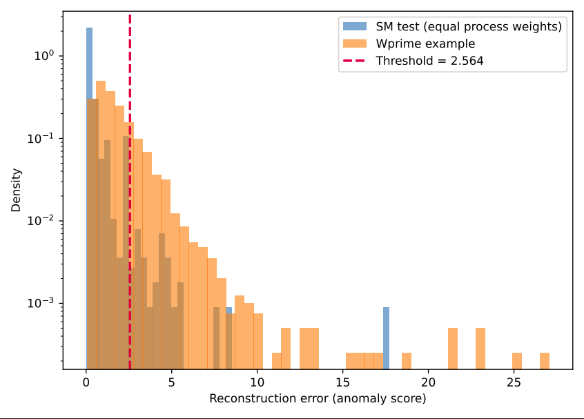
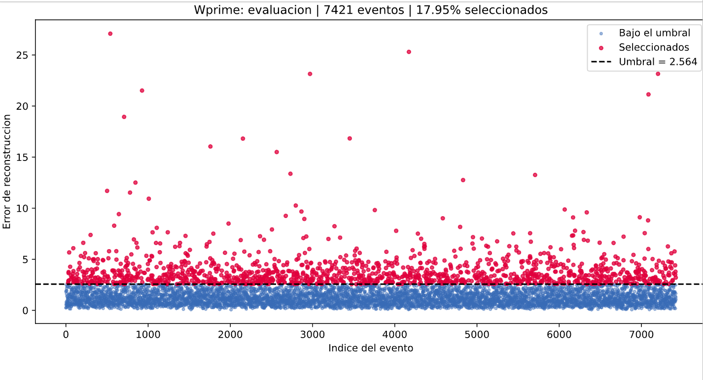

# CMS · Autoencoder y benchmark

La red aprende a reconstruir eventos del **Modelo Estándar**. W′ se utiliza solo para evaluar su respuesta ante eventos distintos.



## 1. Revisar la configuración

Completa primero el [procesamiento NanoAOD y las gráficas de entrada](cms-procesamiento.md). En **hep-workshop → configs**, abre `cms_autoencoder_TU_ETIQUETA.yaml`.

Conserva las diez variables, capas **[16, 8]**, espacio latente **2**, máximo **60 épocas** y paciencia **8**.

## 2. Enviar el entrenamiento

En la misma terminal CMS, usa la etiqueta de tus HDF5:

```bash
export CMS_TAG=baseline02
cd "$HOME/ML-integration-CMSSW"
git pull --ff-only origin opendata_dev
mkdir -p "$HOME/hep-workshop/logs"
export WORKSHOP_CONDA_ENV=ml-open-data
JOB_ID=$(sbatch --parsable --account=curso07 --qos=qoscurso07 \
  --output="$HOME/hep-workshop/logs/cms_ae_%j.out" \
  workshop/run_cpu.slurm autoencoder \
  "$HOME/hep-workshop/configs/cms_autoencoder_${CMS_TAG}.yaml")
echo "Trabajo enviado: $JOB_ID"
```

## 3. Seguir el avance

```bash
tail -F "$HOME/hep-workshop/logs/cms_ae_${JOB_ID}.out"
```

El log muestra las épocas y las pérdidas. **Ctrl+C cierra la consulta; el entrenamiento continúa.** Después comprueba:

```bash
sacct -j "$JOB_ID" --format=JobID,State,ExitCode
```

Continúa cuando indique **`COMPLETED` y `0:0`**. Si falla, revisa el mismo log.

## 4. Abrir los resultados

En JupyterLab abre **hep-workshop → results → cms_autoencoder_tu etiqueta**:

| Archivo | Contenido |
| --- | --- |
| `loss_cms_autoencoder.pdf` | Pérdidas de entrenamiento y validación |
| `scores_by_process_cms_autoencoder.pdf` | Error de reconstrucción por proceso y umbral |
| `ROC_cms_autoencoder.pdf` | Separación SM–W′ |
| `metrics_cms_autoencoder.json` | Conteos, AUC, umbral y eficiencias |

## Resultados del benchmark {#benchmark-cms}

Gráficas de la corrida realizada en Yuca. Pulsa una imagen para ampliarla.

### Pérdidas de entrenamiento y validación

[{ .benchmark-plot }](assets/cms/benchmark_loss_20261020.png)

Ambas pérdidas disminuyen durante el entrenamiento.

### Gráfico representativo: error de reconstrucción por proceso

[{ .benchmark-plot }](assets/cms/benchmark_scores_process_20261020.png)

Compara cada proceso SM con W′: su cola se extiende hacia errores mayores. La línea discontinua marca el umbral **2.564**; los eventos a su derecha se seleccionan como anómalos.

### Comparación SM–W′

[{ .benchmark-plot }](assets/cms/benchmark_scores_sm_20261020.png)

El conjunto SM se representa con igual peso total por proceso.

### Eventos W′ seleccionados

[{ .benchmark-plot }](assets/cms/benchmark_events_wprime_20261020.png)

Cada punto es un evento W′ de evaluación. El umbral **2.564** selecciona el **17.95 % de los 7 421 eventos**, marcados en rojo.

[Anterior: Procesamiento NanoAOD](cms-procesamiento.md){ .md-button }
[Continuar: Interpretación y perspectivas](cms-resultados.md){ .md-button .md-button--primary }
