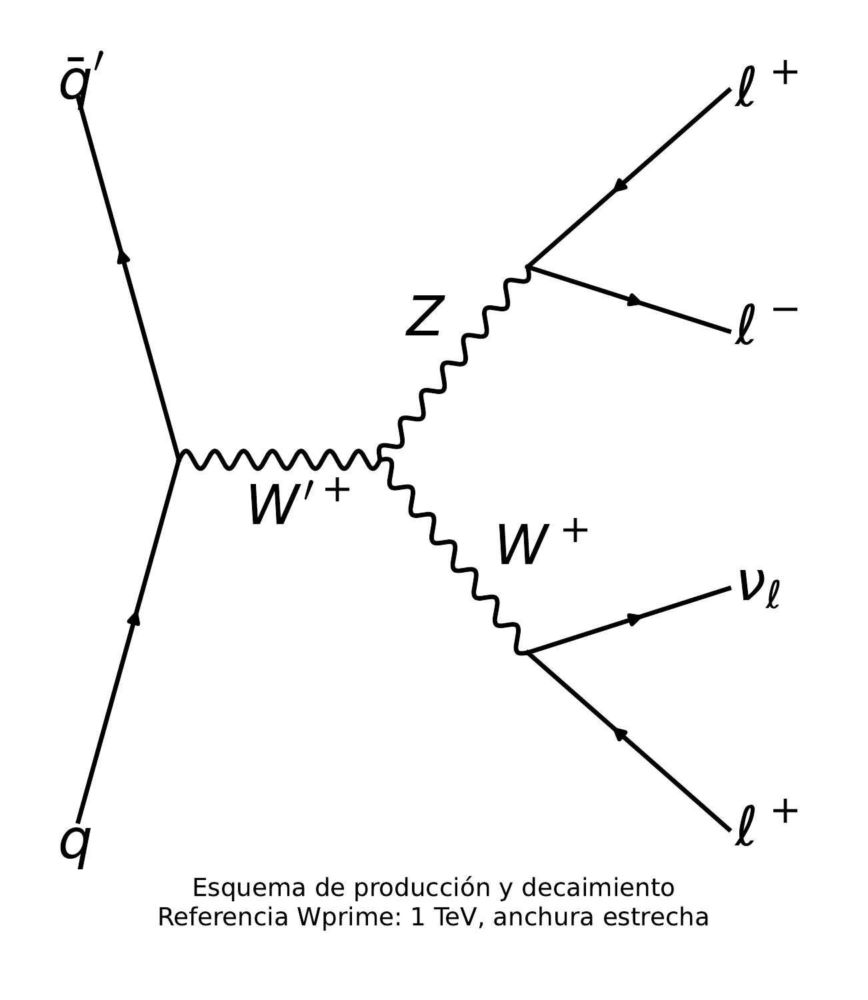
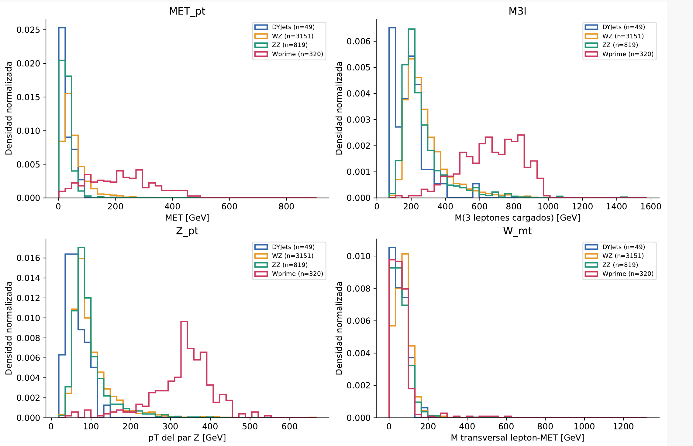

# CMS · Física y variables

## Motivación física: del sector electrodébil a una posible resonancia

Los bosones **W y Z** son mediadores de la interacción débil. Sus decaimientos pueden producir electrones, muones y neutrinos, dando lugar a estados finales multileptónicos que podemos estudiar en CMS.

Algunas extensiones del Modelo Estándar proponen un bosón cargado más pesado, **W′**, que podría decaer en W y Z. En esta demostración usamos una simulación de W′ de **1 TeV y anchura estrecha** como señal de prueba. Es una hipótesis de evaluación, no una partícula observada en estos datos.

{ width="580" }

*W′ → WZ → 3ℓν. En el canal ilustrado, Z produce dos leptones de cargas opuestas y W un leptón y un neutrino; ℓ representa un electrón o un muón. Se considera también el canal conjugado de carga.*

[Ampliar o descargar el diagrama PDF](assets/cms/wprime_decay.pdf).

En el detector esperamos **tres leptones cargados y momento transversal faltante**, relacionado con el neutrino que no se detecta directamente. La producción habitual de WZ puede producir el mismo estado final. La pregunta es si una red entrenada con procesos conocidos responde de forma diferente a eventos de la señal W′. Este estado final se utiliza también en [búsquedas de resonancias de CMS](https://cms-results.web.cern.ch/cms-results/public-results/publications/EXO-12-025/index.html).

## Muestras y formato de origen

Se utilizan simulaciones CMS disponibles en CERN Open Data, en formato **NanoAOD dentro de archivos ROOT**. Cada evento contiene colecciones de electrones, muones y jets, además de otras cantidades reconstruidas, como el momento transversal faltante.

Las muestras del Modelo Estándar son **DYJets HT 70–100, WZ y ZZ**. La muestra **W′ → WZ → 3ℓν**, de masa 1 TeV, se reserva para evaluación. W′ no participa en el entrenamiento del autoencoder.

En el Higgs Challenge las treinta variables ya vienen calculadas en una tabla. Aquí es necesario seleccionar los eventos y construir las variables a partir de las ramas NanoAOD.

## Variables de entrada

Las diez entradas describen la energía transversal del evento, los candidatos W/Z y la geometría de sus decaimientos. Las cantidades de momento y masa se expresan en **GeV**; `Z_deltaR` es adimensional.

| Variable en el YAML | Significado físico |
| --- | --- |
| `MET_pt` | Magnitud del momento transversal faltante: desequilibrio asociado, entre otras contribuciones, al neutrino |
| `M3l` | Masa invariante de los tres leptones cargados; no incluye el neutrino y no es la masa completa de W′ |
| `Lep_pt_sum` | Suma escalar de los momentos transversales de los tres leptones |
| `Z_mass` | Masa invariante del par de leptones asignado al candidato Z |
| `Z_pt` | Momento transversal del candidato Z |
| `Z_deltaR` | Separación angular entre los dos leptones del candidato Z; describe cuán próximos están |
| `Lep1Z_pt`, `Lep2Z_pt` | Momentos transversales de los dos leptones asignados a Z |
| `Lep3W_pt` | Momento transversal del leptón asignado a W |
| `W_mt` | Masa transversal construida con el leptón de W y el momento transversal faltante |

Una resonancia pesada puede producir bosones con mayor momento transversal y modificar la geometría de sus decaimientos. Las variables permiten explorar esas diferencias y sus correlaciones; ninguna por sí sola identifica una nueva partícula.

`Dataset_ID` identifica el proceso de origen y permite separar las muestras. No es una variable de entrada de la red.

## Distribuciones de entrada

El panel muestra **cuatro variables representativas de las diez entradas**: MET, masa de tres leptones, momento transversal de Z y masa transversal de W. Se comparan DYJets, WZ y ZZ de entrenamiento con W′ de evaluación, antes del escalado. Cada proceso está normalizado a área uno; no son rendimientos por luminosidad.

Pulsa la imagen para ampliarla. Los números de la leyenda corresponden a 49 eventos DYJets, 3 151 WZ y 819 ZZ de entrenamiento, y 320 W′ de evaluación. W′ no se utiliza para ajustar la red ni el escalado.

**Para interpretar:** en esta muestra, W′ presenta diferencias claras en MET, masa de tres leptones y momento transversal de Z. Otras variables pueden parecerse más a los procesos SM. La red utiliza conjuntamente las entradas y sus correlaciones; estas curvas no demuestran por sí solas una nueva señal.

**Fuentes.** Diagrama W′ y distribuciones: material del análisis proporcionado por el autor. No son figuras oficiales de CMS.

[Anterior: introducción CMS](autoencoder.md){ .md-button }
[Continuar: Procesamiento NanoAOD](cms-procesamiento.md){ .md-button .md-button--primary }
