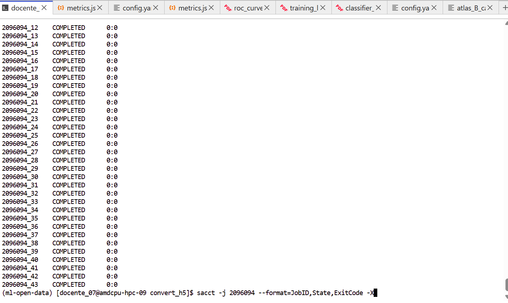
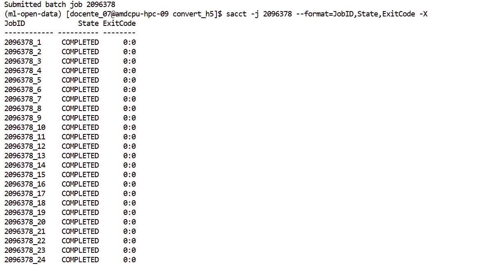

# CMS · Procesamiento desde NanoAOD

Partimos de **muestras públicas de simulación del experimento CMS, disponibles en [CERN Open Data](https://opendata.cern.ch/)**. Los archivos originales están en formato **NanoAOD (ROOT)** y ya se descargaron en Yuca: este es el punto de inicio del ejercicio.

**Diferencia con ATLAS:** allí leíamos una tabla CSV con las variables ya calculadas. En este paso de CMS usamos **ROOT desde Python (PyROOT)** y los módulos **`mini_nanotools`** del repositorio para recorrer los NanoAOD, acceder a las partículas de cada evento y ejecutar la selección de `filterNanoAOD.py`. Después convertimos los ROOT seleccionados a HDF5 para el entrenamiento.

Usaremos los siguientes procesos:

| Muestra | Proceso físico | Papel en el análisis |
| --- | --- | --- |
| **DYJets** | Producción Drell–Yan de pares de leptones acompañados de jets | Muestra del Modelo Estándar; el benchmark histórico utiliza el intervalo HT 70–100 |
| **WZ** | Producción conjunta de un bosón W y un Z | Proceso SM que puede producir tres leptones y momento transversal faltante |
| **ZZ** | Producción de dos bosones Z | Otro proceso SM que contribuye a la muestra multileptónica |
| **W′ → WZ** | Resonancia hipotética de 1 TeV que decae en W y Z | Señal simulada reservada para evaluación; no participa en el entrenamiento |

A partir de las colecciones y ramas NanoAOD, **el código selecciona leptones, aplica filtros por evento, construye candidatos W/Z y calcula variables físicas**. Al terminar tendremos **archivos HDF5 con las cantidades seleccionadas para preparar las diez entradas del autoencoder**, separados por proceso. Sus distribuciones permiten revisar qué información física llega a la red y cómo difieren los procesos SM de W′.

| Punto de partida | Procesamiento | Producto para machine learning |
| --- | --- | --- |
| NanoAOD originales de CMS Open Data, ya descargados | Filtros de eventos, reconstrucción de candidatos y cálculo de observables | HDF5 con variables seleccionadas e identificadores de proceso; diez entradas físicas para la red |

Los NanoAOD compartidos se conservan como fuente. Los ROOT seleccionados y los HDF5 se generan en tu cuenta; la lista exacta de archivos de entrada queda registrada para comparar ejecuciones.

## 1. Activar el ambiente CMS

Ejecuta este bloque en cada terminal nueva, también si vienes de ATLAS o ROOT:

```bash
source /apps/miniconda3/etc/profile.d/conda.sh
conda deactivate
module unload root/6.24.08 rocm/6.4.3
unset PYTHONPATH PYTHONHOME ROOTSYS ROOT_INCLUDE_PATH
conda activate ml-open-data
module load root/6.24.08
cd "$HOME/ML-integration-CMSSW"
git pull --ff-only origin opendata_dev
export PYTHONPATH="$PWD:$(root-config --libdir)"
export CONDA_SETUP_SCRIPT=/apps/miniconda3/etc/profile.d/conda.sh
export SBATCH_QOS=qoscurso07
```

Los datos se leen directamente de `/lustre/cursos/curso07/datos/autoencoder/`; no necesitas copiarlos.

??? info "Solo si todavía no tienes el ambiente CMS"

    Créalo una sola vez en tu cuenta y luego vuelve a la comprobación anterior:

    ```bash
    conda create -n ml-open-data -c conda-forge python=3.11 pip -y
    conda activate ml-open-data
    python -m pip install -r workshop/requirements-yuca.txt
    python -m pip install torch --index-url https://download.pytorch.org/whl/cpu
    ```

## 2. Crear los tres YAML personales

Ejecuta **una sola vez para esta reproducción**:

```bash
python workshop/setup_cms.py \
  --inputs /lustre/cursos/curso07/datos/autoencoder \
  --tag baseline01
```

El preparador utiliza las plantillas de `workshop/configs/`, comprueba que existan archivos ROOT en los cuatro procesos y crea configuraciones conectadas entre sí. También guarda la lista exacta de entradas en `cms_inputs_baseline01.json`. No procesa eventos ni envía trabajos todavía.

En el explorador izquierdo de JupyterLab, abre **hep-workshop → configs**:

| YAML personal | Etapa | Qué revisar |
| --- | --- | --- |
| `cms_processing_baseline01.yaml` | NanoAOD → ROOT seleccionado | `data_processing.datasets`: archivos y procesos; `eos_output_dir`: salida personal ROOT |
| `cms_root2h5_baseline01.yaml` | ROOT seleccionado → HDF5 | `convertion.input_dirs`, `branches` y `eos_output_dir` |
| `cms_autoencoder_baseline01.yaml` | HDF5 → entrenamiento y evaluación | `data.normal_input_paths`, `anomaly_input_paths`, `features`, `output_path`, `model` y `anomaly_detection` |

Haz doble clic en cada YAML para abrirlo como texto. Conserva las rutas generadas y guarda con **Ctrl+S** si editas algún campo. La clave `convertion` conserva la escritura utilizada por el programa.

Las plantillas originales están en [workshop/configs del repositorio](https://github.com/castaned/ML-integration-CMSSW/tree/opendata_dev/workshop/configs): `cms_processing.yaml`, `cms_root2h5.yaml` y `cms_autoencoder.yaml`. Usa las copias personales generadas: ya contienen las rutas completas de tu cuenta.

## 3. Enviar la selección NanoAOD

Desde la misma terminal:

```bash
cd "$HOME/ML-integration-CMSSW/data_processing"
python execute_data_processing.py \
  -f "$HOME/hep-workshop/configs/cms_processing_baseline01.yaml"
```

El comando envía las tareas a Slurm. **Anota el número del trabajo; no añadas otro `sbatch`.** Si usaste otra etiqueta, sustituye `baseline01` en la ruta del YAML.

### Comprobar el procesamiento

```bash
squeue -u "$USER"
sacct -j NUMERO_DEL_TRABAJO --format=JobID,State,ExitCode
```

Sustituye `NUMERO_DEL_TRABAJO` por el recibido. **Continúa solo cuando todas las tareas indiquen `COMPLETED` y `0:0`.** Si alguna falla, revisa `data_processing/logs/`.



Los ROOT seleccionados quedan en **hep-workshop → cms → baseline01 → root**, separados por proceso. Usa tu etiqueta si es distinta y no repitas el envío mientras esté activo.

## 4. Convertir los ROOT seleccionados a HDF5

Después de completar la selección, comprueba que **PyTables** esté disponible en `ml-open-data`. El conversor lo importa con el nombre `tables` para escribir los archivos HDF5:

```bash
python -c "import tables; print('PyTables disponible:', tables.__version__)"
```

Si aparece **`ModuleNotFoundError: No module named 'tables'`**, instálalo una sola vez en el ambiente activo y repite la comprobación:

```bash
python -m pip install tables
python -c "import tables; print('PyTables disponible:', tables.__version__)"
```

Este error ocurre antes del envío de los trabajos de conversión; **no necesitas repetir la selección NanoAOD**. Una vez disponible PyTables, envía la conversión:

```bash
cd "$HOME/ML-integration-CMSSW/data_processing/convert_h5"
python execute_convert_root2h5.py \
  -f "$HOME/hep-workshop/configs/cms_root2h5_baseline01.yaml" \
  --skip-empty-trees
```

Este comando envía otro array a Slurm. Anota su número y comprueba su estado con `squeue` y `sacct`, como en el paso anterior. Sus registros están en **data_processing → convert_h5 → logs**. Se omiten los ROOT sin eventos seleccionados.

Los resultados se guardan en **hep-workshop → cms → baseline01 → h5**, en `DYJets`, `WZ`, `ZZ` y `Wprime`. Cada archivo `.h5` contiene las variables seleccionadas y `Dataset_ID`; las ramas por canal permiten construir las diez entradas físicas del autoencoder.

### Producto del procesamiento: variables listas para el autoencoder

Los HDF5 reúnen las cantidades seleccionadas de cada proceso. Al leerlos, el programa obtiene una fila de diez variables por evento; las cantidades dependientes del canal se toman de los leptones asignados a W/Z y `W_mt` se calcula con el leptón de W y el momento faltante. `Dataset_ID` se conserva para identificar la muestra, sin incorporarlo a las entradas de la red.

### Variables construidas para la red

El código combina las ramas NanoAOD de los leptones y del momento faltante para construir candidatos W/Z y sus observables. Las diez entradas describen la energía transversal del evento, los candidatos W/Z y la geometría de sus decaimientos. Las cantidades de momento y masa se expresan en **GeV**; `Z_deltaR` es adimensional.

| Variable en el YAML | Significado físico |
| --- | --- |
| `MET_pt` | Magnitud del momento transversal faltante: desequilibrio asociado, entre otras contribuciones, al neutrino |
| `M3l` | Masa invariante de los tres leptones cargados; no incluye el neutrino y no es la masa completa de W′ |
| `Lep_pt_sum` | Suma escalar de los momentos transversales de los tres leptones |
| `Z_mass` | Masa invariante del par de leptones asignado al candidato Z |
| `Z_pt` | Momento transversal del candidato Z |
| `Z_deltaR` | Separación angular entre los dos leptones del candidato Z; describe cuán próximos están |
| `Lep1Z_pt`, `Lep2Z_pt` | Momentos transversales de los dos leptones asignados a Z |
| `Lep3W_pt` | Momento transversal del leptón asignado a W |
| `W_mt` | Masa transversal construida con el leptón de W y el momento transversal faltante |

Una resonancia pesada puede producir bosones con mayor momento transversal y modificar la geometría de sus decaimientos. Las variables permiten explorar esas diferencias y sus correlaciones; ninguna por sí sola identifica una nueva partícula.

`Dataset_ID` identifica el proceso de origen y permite separar las muestras. No es una variable de entrada de la red.

### Distribuciones de las variables

El siguiente panel, recuperado del análisis de referencia, muestra **cuatro variables representativas de las diez entradas**: MET, masa de tres leptones, momento transversal de Z y masa transversal de W. Se comparan DYJets, WZ y ZZ de entrenamiento con W′ de evaluación, antes del escalado. Cada proceso está normalizado a área uno; no son rendimientos por luminosidad.

[](assets/cms/input_variables_reference.png)

Pulsa la imagen para ampliarla. Los números de la leyenda corresponden a 49 eventos DYJets, 3 151 WZ y 819 ZZ de entrenamiento, y 320 W′ de evaluación. W′ no se utiliza para ajustar la red ni el escalado.

**Para interpretar:** en esta muestra, W′ presenta diferencias claras en MET, masa de tres leptones y momento transversal de Z. Otras variables pueden parecerse más a los procesos SM. La red utiliza conjuntamente las entradas y sus correlaciones; estas curvas no demuestran por sí solas una nueva señal.

Estas distribuciones ilustran el producto físico de la selección y construcción de variables. El panel corresponde al análisis previo. En el paso 5 generarás tus propias figuras desde los HDF5, con el script de comprobación y visualización.

<div class="image-credits" markdown>

Distribuciones: material del análisis proporcionado por el autor; no son figuras oficiales de CMS.

</div>

## 5. Comprobar los HDF5, generar las gráficas y visualizarlas

**Antes de comprobar los datos o producir las gráficas, cerciórate de que todas las tareas de conversión ROOT → HDF5 hayan terminado con `COMPLETED` y código `0:0`.** Consulta el número del array de conversión —distinto al de selección NanoAOD— y revisa la lista completa:

```bash
sacct -j NUMERO_DEL_ARRAY_DE_CONVERSION --format=JobID,State,ExitCode -X
```

Sustituye `NUMERO_DEL_ARRAY_DE_CONVERSION` por el número recibido al enviar la conversión.



El número `2096378` corresponde únicamente al ejemplo de la captura. No basta con que algunas filas estén completas o que el trabajo desaparezca de `squeue`: **todas las tareas deben haber finalizado correctamente**. Leer los HDF5 mientras se están generando puede dar conteos incompletos, errores de lectura o impedir la división en entrenamiento, validación y prueba.

Después ejecuta la comprobación y genera las distribuciones desde tus propios HDF5:

```bash
cd "$HOME/ML-integration-CMSSW"
python scripts/check_dyjets_ht_pilot.py \
  -f "$HOME/hep-workshop/configs/cms_autoencoder_baseline01.yaml" \
  --plots "$HOME/hep-workshop/cms/baseline01/plots"
```

La comprobación lee los HDF5, valida las diez variables e identificadores y muestra los conteos **SM de entrenamiento, validación y prueba**, además de los eventos W′ de evaluación. Si falta un proceso, una rama o los datos no son válidos, corrige el procesamiento antes de entrenar.

### Abrir y revisar las gráficas en JupyterLab

Si las comprobaciones pasan, el mismo comando genera las figuras **sin entrenar la red**. En el explorador izquierdo abre **hep-workshop → cms → baseline01 → plots** y haz doble clic en:

| Archivo | Qué muestra |
| --- | --- |
| `variables_selected.png` | Panel de cuatro observables: MET, masa de tres leptones, momento de Z y masa transversal W |
| `variables_all.png` | Las diez variables del YAML, comparadas por proceso |
| `variable_MET_pt.png`, `variable_M3l.png`, etc. | Una figura individual para cada variable, con etiquetas físicas y unidades |
| `sample_counts.json` | Conteos utilizados, variables y criterio de normalización |
| `config.yaml` | Copia del YAML que identifica las entradas y la partición utilizada |

Las figuras se guardan también en **PDF y SVG**. DYJets aparece en azul, WZ en ocre, ZZ en verde azulado y W′ en magenta discontinuo. La leyenda indica el número de eventos de cada proceso.

Se muestran **valores originales, antes del escalado**: para SM se utiliza únicamente la partición de entrenamiento definida por el YAML; W′ se incluye solo como comparación de evaluación. Los histogramas utilizan los mismos intervalos y área uno por proceso. Compara sus formas, no tasas físicas ni rendimientos por luminosidad.

**Qué revisar:** ¿en qué variables W′ se desplaza hacia valores altos? ¿Dónde se solapan SM y W′? ¿Algún proceso tiene pocos eventos? Usa estas figuras para comprobar la información física de entrada antes de pasar al entrenamiento.

Para regenerar solo las figuras, sin volver a procesar NanoAOD ni entrenar:

```bash
python workshop/plot_cms_inputs.py \
  -f "$HOME/hep-workshop/configs/cms_autoencoder_baseline01.yaml" \
  --output "$HOME/hep-workshop/cms/baseline01/plots_revision02"
```

Utiliza una carpeta nueva para conservar las figuras anteriores.

Para reproducir los números históricos deben coincidir también los archivos de entrada. El manifiesto conserva los de tu ejecución; compara los conteos con la referencia de la página siguiente. No cambies las variables ni descartes comprobaciones para forzar una coincidencia.

Para una nueva extracción independiente, utiliza otro identificador, por ejemplo `--tag prueba02`; se generan tres YAML nuevos y salidas separadas. El preparador conserva las configuraciones existentes.

[Anterior: Física y objetivo del análisis](cms-fisica.md){ .md-button }
[Continuar: Autoencoder y benchmark](cms-autoencoder.md){ .md-button .md-button--primary }
