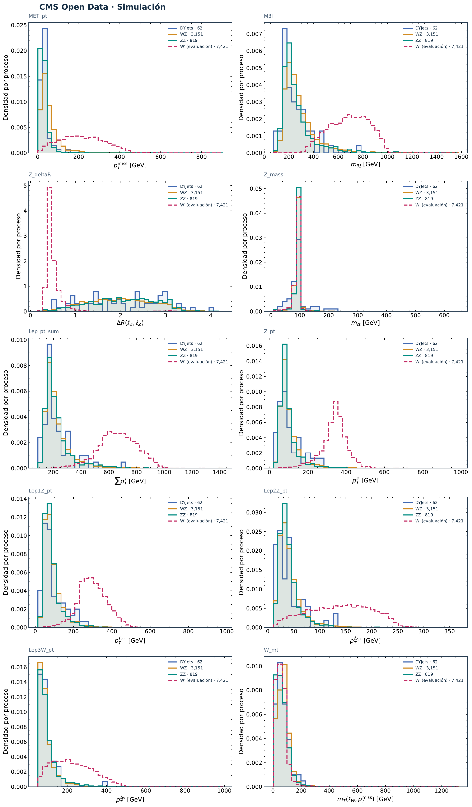

# CMS · De NanoAOD a HDF5 y gráficas

## 1. Activar CMS

Necesitas el repositorio [clonado en tu cuenta](atlas-preparacion.md#clonar-repositorio). Si todavía no tienes el ambiente `ml-open-data`, créalo con este bloque una sola vez:

??? info "Solo la primera vez: crear el ambiente CMS"

    ```bash
    source /apps/miniconda3/etc/profile.d/conda.sh
    conda deactivate
    module unload root/6.24.08 rocm/6.4.3
    unset PYTHONPATH PYTHONHOME ROOTSYS ROOT_INCLUDE_PATH
    module load root/6.24.08
    cd "$HOME/ML-integration-CMSSW"
    CMS_PYTHON="$(root-config --python3-version | cut -d. -f1,2)"
    test -n "$CMS_PYTHON" &&
      conda create -n ml-open-data -c conda-forge "python=$CMS_PYTHON" pip -y &&
      conda activate ml-open-data &&
      python -m pip install -r workshop/requirements-yuca.txt &&
      python -m pip install torch --index-url https://download.pytorch.org/whl/cpu &&
      PYTHONPATH="$PWD:$(root-config --libdir)" python -c "import ROOT, tables, torch, onnx, mini_nanotools; print('CMS listo: ROOT', ROOT.gROOT.GetVersion())"
    ```

    Al ver `CMS listo`, continúa con la activación de abajo.

Copia este bloque en una terminal de JupyterLab, aunque vengas de ATLAS o ROOT:

```bash
source /apps/miniconda3/etc/profile.d/conda.sh
conda deactivate
module unload root/6.24.08 rocm/6.4.3
unset PYTHONPATH PYTHONHOME ROOTSYS ROOT_INCLUDE_PATH
conda activate ml-open-data
module load root/6.24.08
cd "$HOME/ML-integration-CMSSW"
git pull --ff-only origin opendata_dev
export PYTHONPATH="$PWD:$(root-config --libdir)"
export CONDA_SETUP_SCRIPT=/apps/miniconda3/etc/profile.d/conda.sh
export SBATCH_QOS=qoscurso07
```

La selección usa `mini_nanotools`, incluido en el repositorio. Comprueba que quedó disponible:

```bash
python -c "import mini_nanotools; print('mini_nanotools listo')"
```

## 2. Preparar la ejecución

Usa la misma etiqueta en todo el recorrido. El bloque conserva los YAML de `baseline01` si ya existen. **Continúa solo si termina sin errores.**

```bash
export CMS_TAG=baseline01
if [ -f "$HOME/hep-workshop/configs/cms_processing_${CMS_TAG}.yaml" ] &&
   [ -f "$HOME/hep-workshop/configs/cms_root2h5_${CMS_TAG}.yaml" ] &&
   [ -f "$HOME/hep-workshop/configs/cms_autoencoder_${CMS_TAG}.yaml" ]; then
  echo "YAML de $CMS_TAG ya preparados"
else
  python workshop/setup_cms.py \
    --inputs /lustre/cursos/curso07/datos/autoencoder \
    --tag "$CMS_TAG"
fi && printf 'export CMS_TAG=%q\n' "$CMS_TAG" > "$HOME/hep-workshop/cms-session.sh"
```

Mantén la misma terminal durante estos pasos. Si abres otra, activa CMS y ejecuta `source "$HOME/hep-workshop/cms-session.sh"`.

Se crean los tres YAML necesarios en **hep-workshop → configs**. Los datos compartidos se leen sin copiarlos.

## 3. Procesar los NanoAOD

El filtrado de eventos lo hace **`example_files/main_process/filterNanoAOD.py`**. Si estudias otro análisis o estado final, puedes reemplazar ese script de selección; indica la nueva ruta en `data_processing.processing_script` del YAML.

```bash
cd "$HOME/ML-integration-CMSSW/data_processing"
python execute_data_processing.py \
  -f "$HOME/hep-workshop/configs/cms_processing_${CMS_TAG}.yaml"
```

Anota el número del trabajo y comprueba su estado:

```bash
sacct -j NUMERO_DEL_TRABAJO --format=JobID,State,ExitCode
```

Sustituye `NUMERO_DEL_TRABAJO` por el recibido. **Espera a que todas las tareas indiquen `COMPLETED` y `0:0` antes de continuar.** Si alguna falla, revisa **data_processing → logs**.


El número de trabajo de la imagen es solo un ejemplo; consulta el tuyo.

## 4. Convertir a HDF5

```bash
cd "$HOME/ML-integration-CMSSW/data_processing/convert_h5"
python -m pip install tables
python execute_convert_root2h5.py \
  -f "$HOME/hep-workshop/configs/cms_root2h5_${CMS_TAG}.yaml" \
  --skip-empty-trees
```

Comprueba el **nuevo número de trabajo**:

```bash
sacct -j NUMERO_DEL_TRABAJO --format=JobID,State,ExitCode
```

**Espera de nuevo a que todas las tareas indiquen `COMPLETED` y `0:0`.** Los HDF5 quedan en **hep-workshop → cms → tu etiqueta → h5**. Si alguna falla, revisa **data_processing → convert_h5 → logs**.

## 5. Generar y abrir las gráficas

```bash
cd "$HOME/ML-integration-CMSSW"
python scripts/check_dyjets_ht_pilot.py \
  -f "$HOME/hep-workshop/configs/cms_autoencoder_${CMS_TAG}.yaml" \
  --plots "$HOME/hep-workshop/cms/${CMS_TAG}/plots"
```

En el explorador de JupyterLab abre **hep-workshop → cms → tu etiqueta → plots**:

- **`variables_selected.png`**: MET, masa de tres leptones, momento de Z y masa transversal de W.
- **`variables_all.png`**: las diez variables de entrada.

Las gráficas comparan las formas de DYJets, WZ, ZZ y W′, normalizadas por proceso. **Todavía no se entrena la red.** Para repetir solo las gráficas, cambia la carpeta final `plots` por `plots02`.

??? example "Ejemplo para verificar las diez distribuciones"

    Comprueba que tu `variables_all.png` muestre los diez paneles y las cuatro muestras. Los conteos pueden variar entre ejecuciones.

    [](assets/cms/variables_all_reference.png)

[Anterior: Física y objetivo](cms-fisica.md){ .md-button }
[Continuar: Autoencoder y benchmark](cms-autoencoder.md){ .md-button .md-button--primary }
