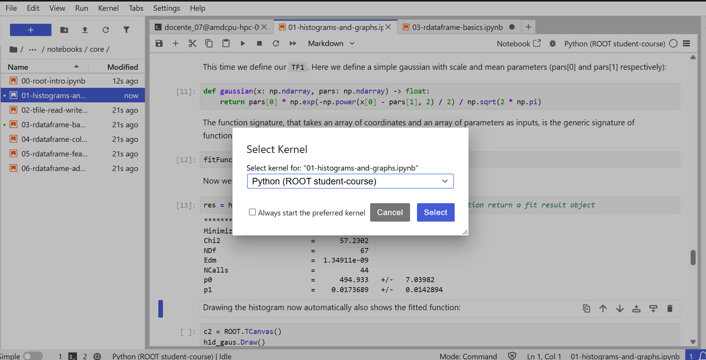

# Curso de ROOT en Yuca

Esta sección permite ejecutar el [curso de ROOT para estudiantes](https://github.com/root-project/student-course), de forma independiente de los ejercicios ATLAS y CMS. Utilizaremos JupyterLab de Yuca y un ambiente personal con **ROOT 6.36**. La instalación probada en Yuca reconoce **ROOT 6.36.14 y Python 3.11**; queda por recorrer todos los notebooks.

## 1. Preparar el ambiente · Solo la primera vez

Abre una terminal en JupyterLab. Para la primera prueba del curso completo puedes reservar **4 cores CPU y 8 GB de memoria**, sin GPU. La parte avanzada crea dos trabajadores Dask locales; estos recursos son una propuesta inicial, no una medición del curso completo.

Primero separa esta sesión de las herramientas del taller:

```bash
source /apps/miniconda3/etc/profile.d/conda.sh
conda deactivate
module unload root/6.24.08 rocm/6.4.3
unset PYTHONPATH PYTHONHOME ROOTSYS ROOT_INCLUDE_PATH
```

Si alguno de los módulos no estaba cargado, no hace falta cargarlo para este curso. **No combines el módulo ROOT 6.24.08 de CMS con el ROOT instalado en Conda.**

Crea el ambiente **una sola vez**. Si ya existe `root-student-course`, pasa al paso 2:

```bash
conda create -n root-student-course \
  --override-channels -c conda-forge --strict-channel-priority \
  python=3.11 'root>=6.36,<6.37' \
  numpy matplotlib mplhep dask distributed \
  jupyterlab ipykernel ipywidgets metakernel -y
```

El ROOT de este ambiente se instala en tu cuenta; no requiere permisos de administrador ni cambia la instalación del sistema. La serie 6.36 cubre UHI y la API distribuida utilizada por los notebooks. [Instalación de ROOT](https://root.cern/install/#conda) · [Notas de ROOT 6.36](https://root.cern/doc/v636/release-notes.html).

## 2. Activar y comprobar ROOT

```bash
conda activate root-student-course
hash -r
python -c "import sys, ROOT; from ROOT.uhi import overflow, underflow; print('Python:', sys.executable); print('ROOT:', ROOT.gROOT.GetVersion()); print('Ubicación:', ROOT.__file__)"
```

Debes obtener **ROOT 6.36.x** y rutas dentro de **`$HOME/.conda/envs/root-student-course/`**. La comprobación de UHI debe completarse sin error.

Si aparece `/apps/root/root-6.24.08/` o el error `libcppyy3_11`, todavía se están mezclando las instalaciones: vuelve a retirar el módulo antiguo con `module unload` y limpiar las variables del primer bloque antes de activar el ambiente. No necesitas reinstalar ROOT.

## 3. Registrar el kernel y descargar el curso · Solo la primera vez

```bash
python -m ipykernel install --user \
  --name root-student-course \
  --display-name "Python (ROOT student-course)" \
  --env PATH "$CONDA_PREFIX/bin:$PATH" \
  --env PYTHONPATH ""
cd "$HOME"
git clone https://github.com/root-project/student-course.git
```

Si ya clonaste el curso, conserva esa carpeta. Actualiza la página de JupyterLab y abre **student-course → course → notebooks → core**. Comienza con `00-root-intro.ipynb` y después `01-histograms-and-graphs.ipynb`.

Selecciona **Kernel → Change Kernel → Python (ROOT student-course)** y pulsa **Select**, como en la captura. También puedes abrir el selector haciendo clic en el nombre del kernel en la esquina superior derecha del notebook.



Después de seleccionarlo, confirma que **Python (ROOT student-course)** aparece en la esquina superior derecha. Esta elección se hace para cada notebook; activar el ambiente en una terminal no cambia el kernel de los notebooks abiertos. Puedes dejar desmarcada **Always start the preferred kernel** para seguir eligiendo el adecuado al cambiar de curso.

En una celda comprueba:

```python
import sys
import ROOT
print(sys.executable)
print(ROOT.gROOT.GetVersion())
print(ROOT.__file__)
```

El notebook debe reconocer el mismo ambiente y ROOT 6.36.x que la terminal. Conserva la estructura del repositorio: los notebooks usan rutas relativas para encontrar `course/data`.

### Si una celda `%%bash` no encuentra `rootls`

El notebook puede importar ROOT correctamente y aun así mostrar `rootls: command not found`: las celdas de shell buscan ejecutables en `PATH`. El registro anterior incluye también la carpeta de ejecutables del ambiente.

Si registraste el kernel sin esa opción, ejecuta en la terminal con el ambiente limpio:

```bash
conda activate root-student-course
command -v rootls
python -m ipykernel install --user \
  --name root-student-course \
  --display-name "Python (ROOT student-course)" \
  --env PATH "$CONDA_PREFIX/bin:$PATH" \
  --env PYTHONPATH ""
```

`command -v rootls` debe mostrar un archivo dentro de `root-student-course/bin`. Si no muestra una ruta, revisa la instalación antes de continuar. Cierra el kernel anterior y vuelve a seleccionar **Python (ROOT student-course)** para que lea la configuración nueva. Ejecuta de nuevo las celdas previas que crean los objetos y archivos.

En una celda Python puedes verificar:

```python
import shutil
print(shutil.which("rootls"))
```

La ruta debe pertenecer al mismo ambiente. Después repite la celda `%%bash` del curso.

## 4. Cambiar entre ROOT, ATLAS y CMS

**La terminal y el notebook tienen ambientes independientes.** `conda activate` cambia los comandos de esa terminal; el notebook utiliza el kernel seleccionado en su menú. Cambiar de ambiente no modifica los trabajos que ya se enviaron a Slurm.

| Actividad | Ambiente de terminal | Herramientas adicionales |
| --- | --- | --- |
| Curso ROOT | `root-student-course` | ROOT 6.36 de Conda y kernel **Python (ROOT student-course)** |
| ATLAS | `ml-hep-gpu` | ROCm 6.4.3; entrenamiento enviado a Slurm |
| CMS | `ml-open-data` | Módulo ROOT 6.24.08 y `mini_nanotools` del repositorio; trabajos enviados a Slurm |

Selecciona el destino y ejecuta el bloque completo en la terminal. Estos bloques son para cambiar de actividad, no para reinstalar los ambientes.

=== "Ir al curso ROOT"

    ```bash
    source /apps/miniconda3/etc/profile.d/conda.sh
    conda deactivate
    module unload root/6.24.08 rocm/6.4.3
    unset PYTHONPATH PYTHONHOME ROOTSYS ROOT_INCLUDE_PATH
    conda activate root-student-course
    cd "$HOME/student-course"
    python -c "import ROOT; print('ROOT:', ROOT.gROOT.GetVersion())"
    ```

    En el notebook elige **Python (ROOT student-course)**. Si el kernel ya estaba abierto con otra configuración, cámbialo o reinícialo y vuelve a comprobar la versión.

=== "Volver a ATLAS"

    ```bash
    source /apps/miniconda3/etc/profile.d/conda.sh
    conda deactivate
    module unload root/6.24.08
    unset PYTHONPATH PYTHONHOME ROOTSYS ROOT_INCLUDE_PATH
    module load rocm/6.4.3
    conda activate ml-hep-gpu
    cd "$HOME/ML-integration-CMSSW"
    ```

    Continúa con el [benchmark ATLAS](laboratorio.md). Ejecuta el entrenamiento mediante Slurm para reservar la GPU.

=== "Volver a CMS"

    ```bash
    source /apps/miniconda3/etc/profile.d/conda.sh
    conda deactivate
    module unload rocm/6.4.3
    unset PYTHONPATH PYTHONHOME ROOTSYS ROOT_INCLUDE_PATH
    conda activate ml-open-data
    module load root/6.24.08
    cd "$HOME/ML-integration-CMSSW"
    export PYTHONPATH="$PWD:$(root-config --libdir):${PYTHONPATH:-}"
    export CONDA_SETUP_SCRIPT=/apps/miniconda3/etc/profile.d/conda.sh
    export SBATCH_QOS=qoscurso07
    python -c "import ROOT; from mini_nanotools import PostProcessor, Module, Collection; print('ROOT CMS:', ROOT.gROOT.GetVersion())"
    ```

    Continúa con el [procesamiento CMS](cms-procesamiento.md). Prepara estas variables antes de enviar los trabajos.

Si dejas de usar un notebook, puedes cerrar su kernel desde **Running Terminals and Kernels** para liberar sus recursos. Cerrar solamente la pestaña no siempre detiene el kernel.

## 5. Datos y ejemplos avanzados

El repositorio incluye archivos ROOT pequeños para las primeras lecciones. Algunos ejemplos de RDataFrame leen archivos desde CERN por HTTPS o XRootD: necesitan acceso a esos servidores desde el nodo de Yuca. Para muchos estudiantes conviene preparar una copia compartida antes del curso.

En las lecciones 05 y 06, limita el paralelismo a los cores reservados: por ejemplo, cambia `ROOT.EnableImplicitMT()` por `ROOT.EnableImplicitMT(2)` si asignas dos hilos al procesamiento. `LocalCluster` de Dask trabaja dentro del nodo de tu sesión; no solicita nodos adicionales a Slurm.

Los notebooks principales usan Python. Algunos ejercicios extra requieren kernel ROOT C++ o contienen configuraciones antiguas de Python 2 y deben revisarse por separado. No todas las celdas son pruebas automáticas: hay ejercicios por completar y errores mostrados con fines didácticos.

[Volver a la introducción](index.md){ .md-button }
