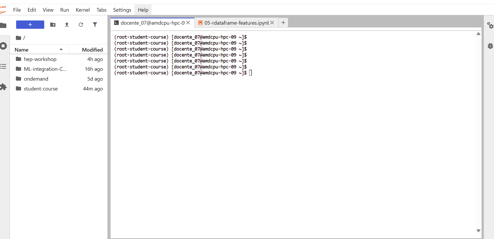

# Taller de ROOT en Yuca

Ejecutaremos los notebooks del [curso de ROOT para estudiantes](https://github.com/root-project/student-course) con **ROOT 6.36 y Python 3.11**, en un ambiente independiente del taller de machine learning. En Yuca ya se probaron ROOT 6.36.14, el kernel y el comando `rootls`.

## 1. Instalar y descargar · Solo la primera vez

**Si ya tienes el ambiente, el kernel y el repositorio, pasa al paso 2.** Para una primera prueba con Dask puedes reservar 4 cores CPU y 8 GB de memoria, sin GPU.

Abre una terminal de JupyterLab y sitúate en tu **carpeta personal (`$HOME`)** antes de crear el ambiente. El curso ROOT se prepara desde allí, separado del repositorio `ML-integration-CMSSW`. El primer comando del bloque te lleva a esa ubicación:

```bash
cd "$HOME"
source /apps/miniconda3/etc/profile.d/conda.sh
conda deactivate
module unload root/6.24.08 rocm/6.4.3
unset PYTHONPATH PYTHONHOME ROOTSYS ROOT_INCLUDE_PATH
conda create -n root-student-course \
  --override-channels -c conda-forge --strict-channel-priority \
  python=3.11 'root>=6.36,<6.37' \
  numpy matplotlib mplhep dask distributed \
  jupyterlab ipykernel ipywidgets metakernel -y
conda activate root-student-course
```

Registra el kernel. La opción `PATH` permite que las celdas `%%bash` encuentren herramientas como `rootls`:

```bash
python -m ipykernel install --user \
  --name root-student-course \
  --display-name "Python (ROOT student-course)" \
  --env PATH "$CONDA_PREFIX/bin:$PATH" \
  --env PYTHONPATH ""
```

Desde **`$HOME`**, descarga el repositorio completo **si todavía no lo tienes**. Se creará **`$HOME/student-course`**, al mismo nivel que `$HOME/ML-integration-CMSSW`:

```bash
cd "$HOME"
git clone https://github.com/root-project/student-course.git
```

Después de clonar, en el **explorador izquierdo de JupyterLab**, vuelve a tu carpeta personal. Debe aparecer una carpeta adicional llamada **`student-course`**, junto a `hep-workshop` y `ML-integration-CMSSW`, como en la imagen. Si aún no la ves, pulsa el botón **Actualizar** del explorador.

{ width="300" }

Conserva la estructura de carpetas: los notebooks buscan los datos mediante rutas relativas.

## 2. Iniciar una sesión o cambiar de taller

Abre [Cambiar de taller](ambientes.md), selecciona la pestaña **ROOT** y ejecuta su bloque en la terminal. Usa esa misma página para volver a **ATLAS** o **CMS**.

**En este curso usamos el ROOT del ambiente Conda; no cargues el módulo `root/6.24.08` de CMS.** Activar el ambiente en una terminal no cambia el kernel de los notebooks.

## 3. Abrir el notebook y elegir el kernel

En el explorador izquierdo abre **student-course → course → notebooks → core**. Comienza con `00-root-intro.ipynb` y sigue con `01-histograms-and-graphs.ipynb`.

En cada notebook selecciona **Kernel → Change Kernel → Python (ROOT student-course)** y pulsa **Select**. También puedes pulsar el nombre del kernel en la esquina superior derecha.


Con el kernel **Python (ROOT student-course)** seleccionado, ejecuta las celdas en orden con **Shift+Enter**.

## 4. Ejemplo breve para el notebook 05

En **`05-rdataframe-features.ipynb`**, sustituye la celda que abre el archivo remoto y suma `nMuon` por este ejemplo de **10 000 eventos sintéticos en memoria**. Ilustra el uso de `RDataFrame` y multihilo sin descargar datos ni conectarse a CERN.

Interrumpe primero la celda anterior si sigue ejecutándose. Después ejecuta:

```python
import ROOT

ROOT.DisableImplicitMT()
ROOT.EnableImplicitMT(2)  # Si reservaste al menos 2 cores CPU
try:
    df_demo = ROOT.RDataFrame(10_000).Define("nMuon", "int(rdfentry_ % 5)")
    print("Suma ilustrativa de nMuon:", df_demo.Sum("nMuon").GetValue())
finally:
    ROOT.DisableImplicitMT()
```

El resultado esperado es **20 000**. `nMuon` recorre los valores 0, 1, 2, 3 y 4: son datos inventados para mostrar la operación, no eventos de CMS. Este ejemplo no mide una ganancia de rendimiento; con tan pocos eventos, preparar el multihilo puede costar más que el propio cálculo.

[Cambiar de taller](ambientes.md){ .md-button .md-button--primary }
