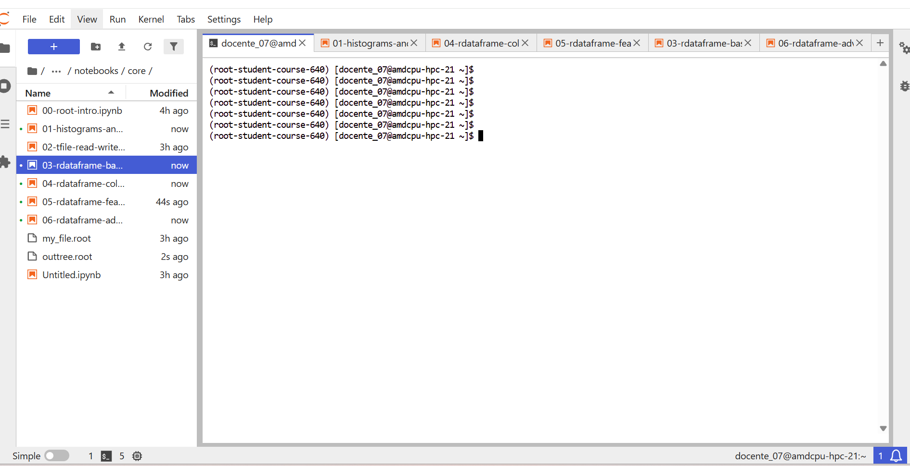
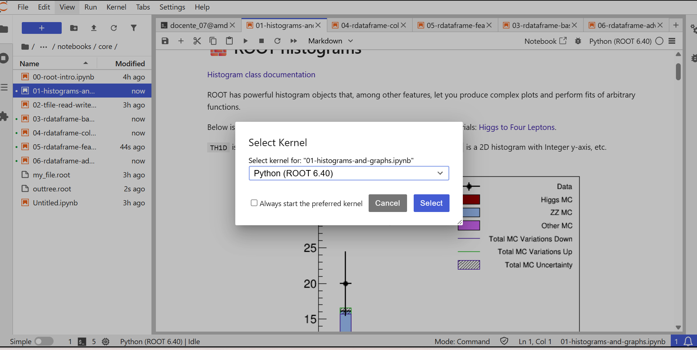

# Taller de ROOT en Yuca

Ejecutaremos los notebooks del [curso de ROOT para estudiantes](https://github.com/root-project/student-course) con **ROOT 6.40 y Python 3.11**, en un ambiente independiente del taller de machine learning. El ambiente y el kernel ROOT 6.40 ya se probaron en Yuca.

## Instructor · Stephan Hageboeck

<div class="instructor-profile" markdown>
<div class="instructor-photo" markdown>


</div>
<div markdown>

Stephan es físico de partículas y obtuvo su doctorado en la **Universidad de Bonn, Alemania**. Trabajó en ATLAS en la búsqueda de decaimientos **Higgs → bb̄** y fue responsable de RooFit en 2019 y 2020, donde impulsó su desarrollo con vectorización y GPU.

Entre 2021 y 2024 trabajó en computación con GPU en el departamento de Tecnologías de la Información del CERN. Actualmente forma parte del **equipo ROOT**, trabajando en RDataFrame, computación con GPU e interfaces de análisis.

[Semblanza y fotografía: equipo ROOT, CERN](https://root.cern/about/team/#Stephan%20Hageboeck).

</div>
</div>

## 1. Instalar y descargar · Solo la primera vez

**Si ya tienes el ambiente, el kernel y el repositorio, pasa al paso 2.** Para una primera prueba con Dask puedes reservar 4 cores CPU y 8 GB de memoria, sin GPU.

Abre una terminal de JupyterLab y sitúate en tu **carpeta personal (`$HOME`)** antes de crear el ambiente. El curso ROOT se prepara desde allí, separado del repositorio `ML-integration-CMSSW`. El primer comando del bloque te lleva a esa ubicación:

```bash
cd "$HOME"
source /apps/miniconda3/etc/profile.d/conda.sh
conda deactivate
module unload root/6.24.08 rocm/6.4.3
unset PYTHONPATH PYTHONHOME ROOTSYS ROOT_INCLUDE_PATH
conda create -n root-student-course-640 \
  --override-channels -c conda-forge --strict-channel-priority \
  python=3.11 'root>=6.40,<6.41' \
  numpy matplotlib mplhep dask distributed \
  jupyterlab ipykernel ipywidgets metakernel pip -y
conda activate root-student-course-640
```

Después de crear el ambiente, actívalo e instala **PyTorch para CPU** una sola vez:

```bash
source /apps/miniconda3/etc/profile.d/conda.sh
conda deactivate
module unload root/6.24.08 rocm/6.4.3
unset PYTHONPATH PYTHONHOME ROOTSYS ROOT_INCLUDE_PATH
conda activate root-student-course-640
python -m pip install torch==2.8.0 --index-url https://download.pytorch.org/whl/cpu
python -c "import ROOT, torch; print('ROOT', ROOT.gROOT.GetVersion(), '| PyTorch', torch.__version__)"
```

En sesiones posteriores, repite solo las líneas hasta `conda activate root-student-course-640`; no reinstales PyTorch. Si el notebook ya estaba abierto durante la instalación, **reinicia su kernel**.

Registra el kernel. La opción `PATH` permite que las celdas `%%bash` encuentren herramientas como `rootls`:

```bash
python -m ipykernel install --user \
  --name root-student-course-640 \
  --display-name "Python (ROOT 6.40)" \
  --env PATH "$CONDA_PREFIX/bin:$PATH" \
  --env PYTHONPATH ""
```

Desde **`$HOME`**, descarga el repositorio completo **si todavía no lo tienes**. Se creará **`$HOME/student-course`**, al mismo nivel que `$HOME/ML-integration-CMSSW`:

```bash
cd "$HOME"
git clone https://github.com/root-project/student-course.git
```

Después de clonar, en el **explorador izquierdo de JupyterLab**, vuelve a tu carpeta personal. Debe aparecer una carpeta adicional llamada **`student-course`**, junto a `hep-workshop` y `ML-integration-CMSSW`. Si aún no la ves, pulsa el botón **Actualizar** del explorador.

La captura siguiente muestra los notebooks dentro de **student-course → course → notebooks → core** y el ambiente ROOT 6.40 activo en la terminal.



Conserva la estructura de carpetas: los notebooks buscan los datos mediante rutas relativas.

## 2. Abrir el notebook y elegir el kernel

En el explorador izquierdo abre **student-course → course → notebooks → core**. Comienza con `00-root-intro.ipynb` y sigue con `01-histograms-and-graphs.ipynb`.

En cada notebook selecciona **Kernel → Change Kernel → Python (ROOT 6.40)** y pulsa **Select**. También puedes pulsar el nombre del kernel en la esquina superior derecha.

Antes de ejecutar las celdas del curso, comprueba en una celda que el notebook usa el ambiente correcto:

```python
import sys, torch
print(sys.executable)
print(torch.__version__)
```

La primera línea debe contener `root-student-course-640`. Si aparece `No module named 'torch'`, ejecuta el bloque de activación e instalación del paso 1, selecciona de nuevo **Python (ROOT 6.40)** y reinicia el kernel.




Con el kernel **Python (ROOT 6.40)** seleccionado, ejecuta las celdas en orden con **Shift+Enter**.

## 3. Archivo compartido para el notebook 05

En **`05-rdataframe-features.ipynb`**, la celda que suma `nMuon` utiliza una dirección `root://eospublic.cern.ch/...`. **Sustituye esa llamada al servidor por la ubicación del archivo compartido en Yuca:**

```python
filename = "/lustre/cursos/curso07/datos/root/Run2012BC_DoubleMuParked_Muons.root"
```

El instructor prepara una sola copia para todos: **no necesitas descargar el archivo ni copiarlo a tu cuenta**. El notebook conserva el ejemplo con datos reales y lee directamente desde el almacenamiento compartido.

El bloque conserva el código original del notebook; **solo cambia `filename`** para leer la copia compartida:

```python
# Activate multithreading capabilities
# By default takes all available cores on the machine
ROOT.EnableImplicitMT()

treename = "Events"
filename = "/lustre/cursos/curso07/datos/root/Run2012BC_DoubleMuParked_Muons.root"
df = ROOT.RDataFrame(treename, filename)

df.Sum("nMuon").GetValue()

# Disable implicit multithreading when done
ROOT.DisableImplicitMT()
```

Esta lectura evita depender de la conexión a CERN, aunque el cálculo sigue recorriendo todos los eventos del archivo.

[Cambiar de taller](ambientes.md){ .md-button .md-button--primary }
