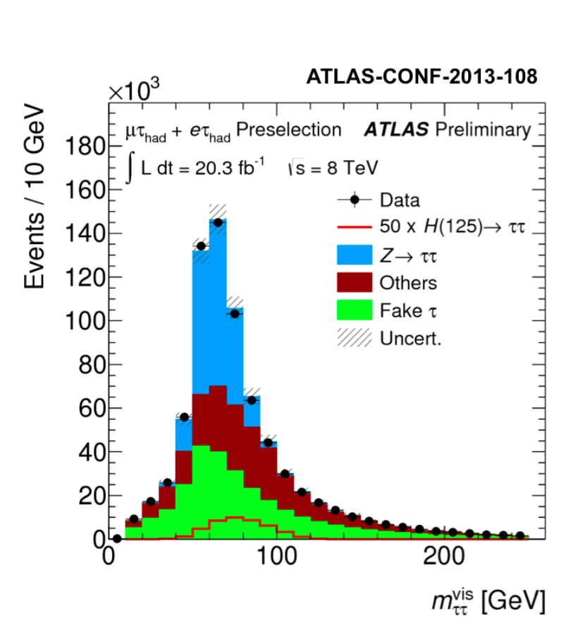

# La física detrás del Higgs Challenge

## Proceso físico y respuesta del detector

{ width="800" }

*Producción: (a) fusión de gluones; (b) fusión de bosones vectoriales, con quarks salientes que pueden producir jets. Recorte de la figura 1 de la [publicación conjunta ATLAS y CMS, arXiv:1606.02266](https://arxiv.org/abs/1606.02266). Estos diagramas contextualizan la producción; no proceden del artículo del challenge.*

La señal del reto es **H → τ⁺τ⁻**. Un tau decae a electrón o muón y neutrinos; el otro produce hadrones y un neutrino. Por eso buscamos **un leptón, un tau hadrónico y momento transversal faltante**, a veces acompañados de jets.

### El estado final que buscamos

*Un tau decae a electrón o muón y dos neutrinos; el otro, a hadrones y un neutrino.*

**Observamos un leptón y un tau hadrónico.** Los tres neutrinos contribuyen al momento transversal faltante (MET), por lo que la masa visible no describe todo el decaimiento.

**Fondos principales:** Z → ττ, pares de top y W + jets, que pueden producir objetos similares a la señal.

{ width="460" }

*Figura 1 extraída del [artículo del Higgs Challenge](https://proceedings.mlr.press/v42/cowa14.pdf), que reproduce el resultado ATLAS-CONF-2013-108. La línea roja de señal está multiplicada por **50**, como indica la leyenda. Esta figura publicada contiene datos y estimaciones de fondo; nuestros entrenamientos usan simulaciones del dataset. No confundir sus cantidades con las de nuestros histogramas normalizados.*

**Pregunta para el salón:** si señal y fondo pueden producir objetos similares, ¿qué combinaciones de masas, direcciones y momentos podrían ayudarnos?

## Las 30 variables, organizadas por su significado

**El YAML `features: all_physics` utiliza las 30 variables siguientes.** `PRI_` identifica 17 cantidades primarias y `DER_` las 13 construidas combinando otras cantidades.

### Definición de observables

- **pT:** momento perpendicular al haz, en GeV.
- **η:** pseudorrapidez; expresa la dirección respecto al haz. Cerca de cero corresponde a la región transversal.
- **φ:** ángulo alrededor del haz, en radianes.
- **Jet:** conjunto de partículas asociado a un quark o gluón.
- **MET:** desequilibrio transversal observado; puede revelar neutrinos, aunque también depende de la resolución del detector.
- **Masa visible:** usa lo detectado; no recupera automáticamente la energía de los neutrinos.

### Objetos reconstruidos: 17 variables primarias

Definiciones resumidas del [registro oficial de datos](https://opendata.cern.ch/record/328). Los jets se ordenan por pT: «leading» es el primero, «subleading» el segundo.

| Variable | Qué representa |
| --- | --- |
| `PRI_tau_pt` | pT del tau hadrónico reconstruido |
| `PRI_tau_eta` | Su pseudorrapidez |
| `PRI_tau_phi` | Su ángulo azimutal |
| `PRI_lep_pt` | pT del electrón o muón |
| `PRI_lep_eta` | Pseudorrapidez del leptón |
| `PRI_lep_phi` | Ángulo azimutal del leptón |
| `PRI_met` | Magnitud del MET |
| `PRI_met_phi` | Dirección azimutal del MET |
| `PRI_met_sumet` | Energía transversal total registrada |
| `PRI_jet_num` | Número de jets; 3 representa tres o más |
| `PRI_jet_leading_pt` | pT del primer jet |
| `PRI_jet_leading_eta` | Pseudorrapidez del primer jet |
| `PRI_jet_leading_phi` | Ángulo azimutal del primer jet |
| `PRI_jet_subleading_pt` | pT del segundo jet |
| `PRI_jet_subleading_eta` | Pseudorrapidez del segundo jet |
| `PRI_jet_subleading_phi` | Ángulo azimutal del segundo jet |
| `PRI_jet_all_pt` | Suma escalar de pT de todos los jets |

Estas cantidades describen los objetos del evento. No esperamos que cada una discrimine por sí sola: también importan sus relaciones y las condiciones de detección.

### Combinaciones físicas: 13 variables derivadas

Resumen de la [documentación del challenge](https://opendata.cern.ch/record/329), con las definiciones detalladas en su apéndice.

| Variable | Qué combina |
| --- | --- |
| `DER_mass_MMC` | Masa ττ estimada considerando los neutrinos |
| `DER_mass_transverse_met_lep` | Masa transversal leptón–MET |
| `DER_mass_vis` | Masa del tau visible y el leptón |
| `DER_pt_h` | Suma vectorial transversal tau, leptón y MET |
| `DER_deltaeta_jet_jet` | Separación en η entre los dos jets |
| `DER_mass_jet_jet` | Masa del par de jets |
| `DER_prodeta_jet_jet` | Producto de las η de ambos jets |
| `DER_deltar_tau_lep` | Separación angular tau–leptón en η y φ |
| `DER_pt_tot` | Balance transversal: tau, leptón, MET y hasta dos jets |
| `DER_sum_pt` | Suma escalar de pT del tau, leptón y jets |
| `DER_pt_ratio_lep_tau` | Cociente pT del leptón / pT del tau |
| `DER_met_phi_centrality` | Posición angular del MET respecto a tau y leptón |
| `DER_lep_eta_centrality` | Posición del leptón en η respecto a los jets |

**Tres ideas físicas:** las masas ayudan a distinguir hipótesis de origen; el MET informa sobre componentes invisibles; los jets y sus separaciones aportan información sobre la producción. La red puede combinar estas pistas sin que nosotros fijemos todos los cortes.

Si no hay dos jets, algunas variables no están definidas. El valor `-999` lo señala: no es una masa o un momento físico. La preparación automática lo trata antes del entrenamiento. Las columnas de etiqueta, pesos, identificador y partición no cuentan entre las 30 entradas.

## Distribuciones de las variables

Las siguientes ocho variables ilustran la información que recibe la red: los objetos reconstruidos, el momento transversal faltante y sus combinaciones físicas. **El entrenamiento conserva las treinta variables** descritas arriba.

Las curvas comparan formas de señal y fondo en la muestra de entrenamiento del challenge, sin pesos de evento. Se excluyen los valores ausentes y se normaliza cada clase antes de recortar las colas al percentil 99.5. No representan los rendimientos físicos esperados.

### MET y momentos transversales

MET recoge el desequilibrio transversal asociado, entre otras contribuciones, a los neutrinos. Los momentos del leptón, del tau hadrónico y del jet principal describen la actividad visible del evento. El gráfico del jet incluye únicamente eventos donde esa variable está definida.

### Masas y separación angular

Las variables compuestas relacionan los objetos del evento. La masa MMC estima la masa del candidato Higgs; la masa visible utiliza solo el leptón y el tau reconstruidos. La masa transversal combina el leptón con MET, y ΔR mide la separación angular entre el leptón y el tau.

**Para discutir:** ¿qué variables presentan diferencias más visibles? ¿Por qué podría ayudar a la red combinar observables que por separado se parecen?

## Del proceso físico al entrenamiento

La red utilizará las treinta variables para distinguir la señal de los procesos de fondo. En el siguiente ejercicio se reproducirá una configuración de referencia, se identificarán los archivos de resultados y, después, se estudiarán modificaciones del modelo.

El canal **H → ττ ya fue observado en el LHC**. Una mejor separación entre señal y fondo puede ayudar a reducir las incertidumbres en la medición de su sección eficaz. [ATLAS](https://atlas.cern/updates/briefing/higgs-couples-heaviest-lepton).

## Siguiente paso

Identificar qué objetos se esperan en los eventos y qué representan las variables de entrada. A continuación, reproducir la red de referencia y localizar los archivos generados.

[Anterior: preparar el entorno](atlas-preparacion.md){ .md-button }
[Continuar: ejecutar el benchmark](laboratorio.md){ .md-button .md-button--primary }

**Procedencia de las imágenes.**

- `atlas_observables/`: distribuciones de los 250 000 eventos de entrenamiento del [dataset de CERN Open Data](https://opendata.cern.ch/record/328), utilizando `workshop/plot_atlas.py` del repositorio principal. [Condiciones de generación y conteos](assets/workshop/atlas_observables/provenance.json). No son figuras oficiales de ATLAS.

- `higgs_ggf_vbf.png`: figura 1 de ATLAS y CMS, [arXiv:1606.02266](https://arxiv.org/abs/1606.02266), recortada para mostrar los diagramas.
- `higgs_tautau_final_state.svg/png`: esquema original del taller de la cadena leptónica–hadrónica de H → ττ; no es una figura extraída del artículo.
- `challenge_visible_mass.png`: figura 1 de Adam-Bourdarios et al., [PMLR 42 (2015)](https://proceedings.mlr.press/v42/cowa14.html), con el crédito original a ATLAS-CONF-2013-108 preservado.

Los diagramas de producción se obtuvieron de la publicación conjunta, porque el artículo y la documentación del challenge no contienen ese tipo de diagramas. La cadena completa H → ττ se elaboró como esquema didáctico para este curso. Ninguna de estas figuras es un resultado de nuestros entrenamientos.

