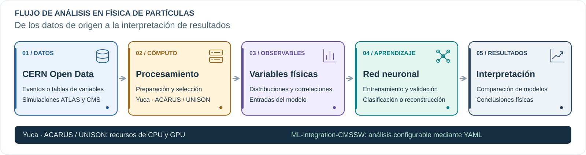

---
hide:
  - navigation
  - toc
---

Universidad de Sonora · Curso práctico

# Aprendizaje automático en física de partículas

Análisis de datos de física de partículas con CERN Open Data y el clúster Yuca: desde la preparación de los datos hasta la interpretación de resultados.

Cómputo en CPU y GPU del clúster Yuca ACARUS · Universidad de Sonora

[Acceso y preparación](preparacion.md){ .md-button .md-button--primary }
[Ejercicio ATLAS](laboratorio.md){ .md-button .hero-secondary }
[Ejercicio CMS](autoencoder.md){ .md-button .hero-secondary }

Figura 1. Decaimiento H → ττ en el canal leptón–tau hadrónico.

## El flujo de un análisis experimental

En el curso practicaremos las etapas de un análisis de física experimental de partículas: partir de una fuente de datos, procesarlos en un clúster, estudiar observables y extraer conclusiones. Las redes neuronales son una herramienta opcional dentro de este flujo; en los dos ejercicios las utilizaremos con objetivos distintos.

El recorrido directo permite analizar distribuciones y selecciones. La rama inferior incorpora el entrenamiento y la evaluación de una red. En ambos casos, las conclusiones se sustentan en los resultados y sus limitaciones. Trabajaremos con **simulaciones abiertas de ATLAS y CMS**, disponibles en CERN Open Data.

<strong>30</strong>variables para explorar

<strong>250 mil</strong>eventos para desarrollar el modelo

<strong>CPU ↔ GPU</strong>comparación de tiempos de entrenamiento

<strong>1 YAML</strong>por experimento; una carpeta por resultado

!!! info "Primer paso: preparar tu acceso y tu cuenta"
    La [preparación inicial en Yuca](preparacion.md) explica el primer SSH, la doble verificación, cómo trabajar desde Open OnDemand o JupyterLab y cómo solicitar recursos de ACARUS. Esta preparación es necesaria antes de iniciar los ejercicios.

## Dos ejercicios con CERN Open Data

Los dos ejercicios siguen el esquema anterior. En ATLAS comenzamos con variables ya calculadas; en CMS realizamos también la selección de eventos y la extracción de observables desde NanoAOD.

| | Ejercicio 1 · ATLAS Higgs Challenge | Ejercicio 2 · Autoencoder CMS |
| --- | --- | --- |
| Datos de origen | Tabla CSV comprimida (`.csv.gz`) del challenge | Archivos ROOT en formato NanoAOD (`.root`) |
| Contenido | Una fila por evento, con 30 variables físicas ya calculadas | Colecciones de partículas reconstruidas y propiedades del evento |
| Procesamiento | Lectura de la tabla, tratamiento de valores ausentes y estandarización | Selección de eventos, reconstrucción de candidatos W/Z, cálculo de observables y conversión a HDF5 |
| Modelo | Red completamente conectada de clasificación supervisada | Autoencoder entrenado con eventos del Modelo Estándar |
| Objetivo | Distinguir Higgs → ττ de los procesos de fondo | Estudiar eventos con errores de reconstrucción elevados |
| Evaluación | Curva ROC, AUC y AMS interna | Pérdidas y distribuciones del error de reconstrucción; W′ como referencia de evaluación |
| Lugar en el curso | Actividad principal del miércoles | Extensión para mostrar el análisis desde NanoAOD |

**ATLAS · Higgs:** tabla de variables → preparación en Yuca → clasificador de señal y fondo → comparación de entrenamientos y conclusiones.

**CMS · Anomalías:** NanoAOD → selección y extracción de variables en Yuca → HDF5 → autoencoder → estudio del error de reconstrucción y conclusiones.

[Ejercicio 1: ATLAS Higgs Challenge](fisica.md){ .md-button .md-button--primary }
[Ejercicio 2: autoencoder CMS](autoencoder.md){ .md-button }

## Software y archivos de configuración

El software del curso está disponible en [ML-integration-CMSSW](https://github.com/castaned/ML-integration-CMSSW). Mediante archivos **YAML** podrás configurar el procesamiento de los datos, definir la arquitectura y los parámetros de entrenamiento de las redes, y elegir dónde guardar tus resultados.

## Objetivos del ejercicio ATLAS

El ejercicio principal consiste en distinguir la señal **Higgs → ττ** de los procesos de fondo mediante el **ATLAS Higgs Challenge**, un conjunto de simulaciones disponible en CERN Open Data.

Se estudiará el efecto de la arquitectura y de los parámetros de entrenamiento sobre la discriminación entre señal y fondo, el sobreajuste y el tiempo de cómputo. Cada configuración se conservará junto con sus resultados para comparar los experimentos.

<a class="journey-card" href="fisica/">
01 / MOTIVACIÓN FÍSICA
<h3>Procesos y observables</h3>

Producción y decaimiento del Higgs, procesos de fondo y variables de entrada.

Consultar la física →
</a>
<a class="journey-card" href="laboratorio/">
02 / BENCHMARK
<h3>Entrenamiento de referencia</h3>

Arquitectura inicial, ejecución en Yuca y revisión de los archivos de resultados.

Reproducir el benchmark →
</a>
<a class="journey-card" href="variaciones/">
03 / EXPERIMENTOS
<h3>Variaciones e interpretación</h3>

Modificaciones del YAML por grupo, registro de métricas y comparación de los entrenamientos.

Realizar las variaciones →
</a>
<a class="journey-card" href="conclusiones/">
04 / CONCLUSIONES
<h3>Discusión de resultados</h3>

Síntesis de la comparación, evidencia de las figuras y limitaciones de las conclusiones.

Preparar la discusión →
</a>

## Durante la sesión

Trabajaremos individualmente o en grupos cercanos, según la disposición del salón. Todos partimos de una referencia y probamos al menos una variación. Si hay tiempo, exploramos una segunda idea.

**Miércoles · 3 horas** Dos horas de configuración, introducción y benchmark. Una hora de [variaciones por grupos y discusión](variaciones.md).

**Jueves · 1 hora** Comparación de resultados y exploración de un autoencoder CMS.

### Presentación de resultados

Cada grupo presentará la configuración estudiada, su comparación con la referencia y las conclusiones sustentadas por los resultados.

[Preparar mi cuenta](preparacion.md){ .md-button }
[Manual técnico de la herramienta](https://castaned.github.io/ML-integration-CMSSW/){ .text-link }

El código de entrenamiento y los YAML se mantienen en [ML-integration-CMSSW](https://github.com/castaned/ML-integration-CMSSW/tree/opendata_dev/workshop). Este sitio reúne el material docente. Cómputo en **ACARUS / Yuca, Universidad de Sonora**. Figuras publicadas y fuentes identificadas en el [capítulo de física](fisica.md#procedencia-de-las-imagenes).
