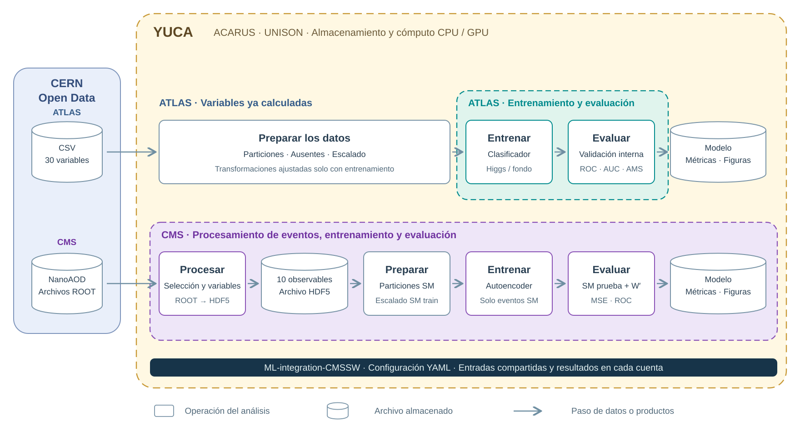
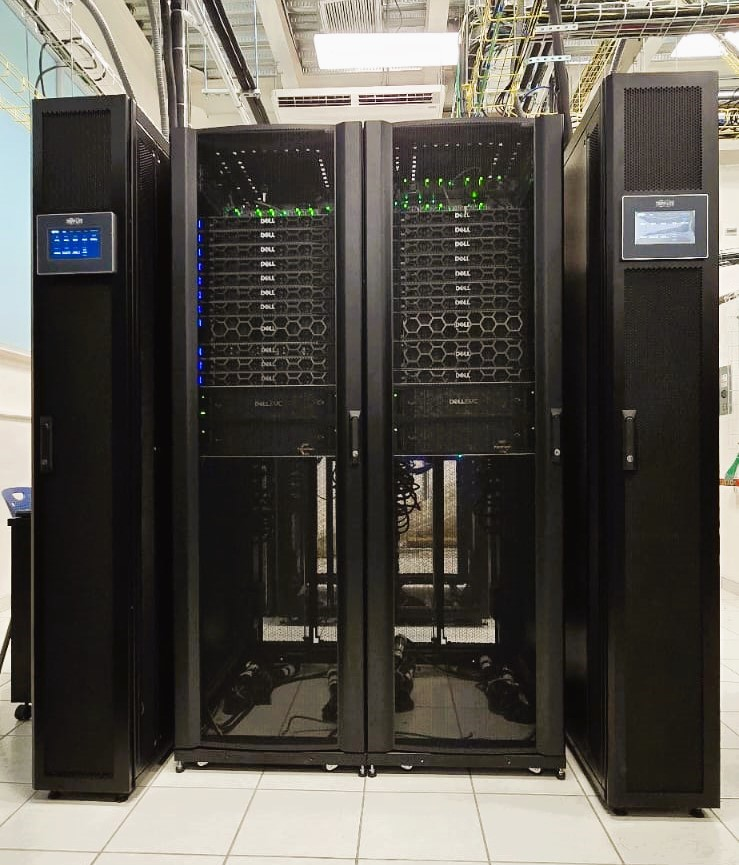

---
hide:
  - navigation
  - toc
---

XXI Mexican School on Particles and Fields

<strong>19–23 de octubre de 2026</strong> · Puebla, México

Edificio Carolino · Ciudad Universitaria 2

<a href="https://indico.nucleares.unam.mx/event/2675/timetable/">Agenda oficial del evento</a>

Taller práctico

# Practical Machine Learning for HEP Data Analysis

Análisis de datos abiertos de ATLAS y CMS con redes neuronales.

Física de partículas · Ciencia de datos · Supercómputo

<a class="open-data-brand" href="https://opendata.cern.ch/" aria-label="Visitar el portal CERN Open Data">

Portal de datos abiertos
</a>

<h2>CERN Open Data</h2>

El portal reúne datos de experimentos de física de partículas, software y documentación para su análisis. Este acceso permite trabajar con muestras abiertas y reproducir estudios de procesos físicos.

En el taller utilizaremos simulaciones de <strong>ATLAS y CMS</strong> para recorrer las etapas del análisis, desde los datos de origen hasta la interpretación de los resultados.

<a href="https://opendata.cern.ch/">Explorar el portal oficial →</a>

Logotipo: CERN Open Data.

## El flujo de un análisis experimental

En el curso practicaremos las etapas de un análisis de física experimental de partículas: partir de una fuente de datos, procesarlos en un clúster, estudiar observables y extraer conclusiones. El entrenamiento de redes neuronales forma parte del recorrido de los dos ejercicios, con un énfasis diferente en cada uno.

### Arquitectura de los ejercicios {#aplicacion-a-los-ejercicios-del-curso}

## Datos, infraestructura y software de análisis

<h3>Yuca · Cómputo de alto rendimiento en la UNISON</h3>

El clúster Yuca, operado por el Área de Cómputo de Alto Rendimiento (ACARUS) de la Universidad de Sonora, aporta la infraestructura para procesar las muestras y entrenar los modelos del curso.

Un clúster reúne nodos de cómputo que permiten distribuir tareas. En un análisis de partículas, esto facilita procesar distintos archivos de eventos y comparar entrenamientos. Las CPU realizan tareas generales y las GPU pueden acelerar los cálculos de las redes neuronales.

<dl class="yuca-capacity">

<dt>24 nodos CPU</dt><dd>Procesamiento de datos</dd>

<dt>6 nodos GPU · MI210</dt><dd>Cómputo acelerado</dd>

<dt>36.77 TB de RAM</dt><dd>Memoria total publicada</dd>

<dt>3.25 PB</dt><dd>Almacenamiento HDD y SSD</dd>

</dl>

Capacidades globales publicadas por ACARUS. <a href="https://acarus.unison.mx/hardware/">Ficha oficial de hardware de Yuca</a>.

<figure>

<figcaption>Clúster Yuca. Fotografía: <a href="https://acarus.unison.mx/hardware/">ACARUS · Universidad de Sonora</a>.</figcaption>
</figure>

## Programa del taller

**20, 21 y 23 de octubre de 2026 · Sala de Proyecciones, Edificio Carolino, Puebla.** Horarios en hora local de Puebla.

<article class="agenda-day">
<header class="agenda-day-header"><h3>Martes 20</h3>1 h 15 min</header>
<ol class="agenda-stages">
<li>11:45–13:00<h4>Introducción y preparación</h4>
Flujo de análisis, acceso a Yuca, física del Higgs y variables de entrada.
</li>
</ol>
</article>
<article class="agenda-day">
<header class="agenda-day-header"><h3>Miércoles 21</h3>2 h 45 min</header>
<ol class="agenda-stages">
<li>15:30–16:45 · 1 h 15 min<h4>Benchmark ATLAS</h4>
Entrenamiento de la red inicial, seguimiento de su avance y revisión de figuras y métricas.
</li>
<li>17:00–18:30 · 1 h 30 min<h4>Variaciones del entrenamiento</h4>
Cambios en el YAML por estudiante o grupo y comparación con la referencia.
</li>
</ol>
</article>
<article class="agenda-day agenda-day-second">
<header class="agenda-day-header"><h3>Viernes 23</h3>1 h 15 min</header>
<ol class="agenda-stages">
<li>11:45–13:00<h4>Discusión y análisis CMS</h4>
Comparación de resultados ATLAS y recorrido CMS: procesamiento NanoAOD, variables y autoencoder.
</li>
</ol>
</article>

[Comenzar con el acceso y la preparación](preparacion.md){ .md-button .md-button--primary }
