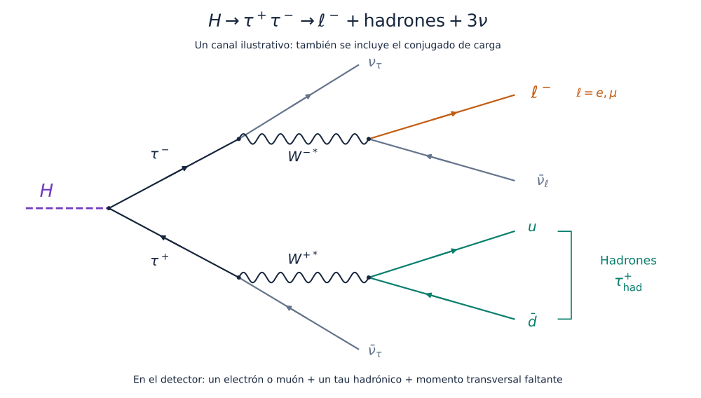

---
hide:
  - navigation
  - toc
---

Universidad de Sonora · Curso práctico

# Aprendizaje automático en física de partículas

Redes neuronales aplicadas a datos abiertos del CERN: clasificación de eventos con el ATLAS Higgs Challenge y análisis desde NanoAOD con CMS.

Cómputo en CPU y GPU del clúster Yuca ACARUS · Universidad de Sonora

[Acceso y preparación](preparacion.md)
[Ejercicio ATLAS](laboratorio.md)
[Ejercicio CMS](autoencoder.md)

Figura 1. Decaimiento H → ττ en el canal leptón–tau hadrónico.

<strong>30</strong>variables para explorar

<strong>250 mil</strong>eventos para desarrollar el modelo

<strong>CPU ↔ GPU</strong>comparación de tiempos de entrenamiento

<strong>1 YAML</strong>por experimento; una carpeta por resultado

!!! info "Primer paso: preparar tu acceso y tu cuenta"
    La [preparación inicial en Yuca](preparacion.md) explica el primer SSH, la doble verificación, cómo trabajar desde Open OnDemand o JupyterLab y cómo solicitar recursos de ACARUS. Esta preparación es necesaria antes de iniciar los ejercicios.

## Dos ejercicios con CERN Open Data

Ambos ejercicios utilizan simulaciones disponibles en CERN Open Data. Difieren en el formato de origen, el procesamiento necesario y la tarea de aprendizaje.

| | Ejercicio 1 · ATLAS Higgs Challenge | Ejercicio 2 · Autoencoder CMS |
| --- | --- | --- |
| Datos de origen | Tabla CSV comprimida (`.csv.gz`) del challenge | Archivos ROOT en formato NanoAOD (`.root`) |
| Contenido | Una fila por evento, con 30 variables físicas ya calculadas | Colecciones de partículas reconstruidas y propiedades del evento |
| Procesamiento | Lectura de la tabla, tratamiento de valores ausentes y estandarización | Selección de eventos, reconstrucción de candidatos W/Z, cálculo de observables y conversión a HDF5 |
| Modelo | Red completamente conectada de clasificación supervisada | Autoencoder entrenado con eventos del Modelo Estándar |
| Objetivo | Distinguir Higgs → ττ de los procesos de fondo | Estudiar eventos con errores de reconstrucción elevados |
| Evaluación | Curva ROC, AUC y AMS interna | Pérdidas y distribuciones del error de reconstrucción; W′ como referencia de evaluación |
| Lugar en el curso | Actividad principal del miércoles | Extensión para mostrar el análisis desde NanoAOD |

**ATLAS:** CSV con variables preparadas → preprocesamiento → clasificación → comparación de entrenamientos.

**CMS:** NanoAOD → selección y extracción de variables → HDF5 → reconstrucción con autoencoder → evaluación.

[Ejercicio 1: ATLAS Higgs Challenge](fisica.md){ .md-button .md-button--primary }
[Ejercicio 2: autoencoder CMS](autoencoder.md){ .md-button }

## Objetivos del ejercicio ATLAS

El ejercicio principal consiste en distinguir la señal **Higgs → ττ** de los procesos de fondo mediante el **ATLAS Higgs Challenge**, un conjunto de simulaciones disponible en CERN Open Data.

Se estudiará el efecto de la arquitectura y de los parámetros de entrenamiento sobre la discriminación entre señal y fondo, el sobreajuste y el tiempo de cómputo. Cada configuración se conservará junto con sus resultados para comparar los experimentos.

<a class="journey-card" href="fisica/">
01 / ENTENDER
<h3>Procesos y observables</h3>

Descripción de la señal, los procesos de fondo y las 30 variables de entrada.

Explorar el proceso →
</a>

<a class="journey-card" href="laboratorio/">
02 / EXPERIMENTAR
<h3>Entrenamiento de la red</h3>

Configuración de capas, neuronas y parámetros de entrenamiento mediante archivos YAML.

Entrar al laboratorio →
</a>

<a class="journey-card" href="bitacora/">
03 / INTERPRETAR
<h3>Registro de resultados</h3>

Comparación de curvas de aprendizaje, métricas de clasificación y tiempos de ejecución.

Abrir la bitácora →
</a>

<a class="journey-card" href="conclusiones/">
04 / DISCUTIR
<h3>Análisis y conclusiones</h3>

Discusión de las diferencias observadas y de las limitaciones de cada configuración.

Compartir conclusiones →
</a>

## Configuración de la arquitectura

ARQUITECTURAS DE REFERENCIA
<h3>Capas y parámetros entrenables</h3>

El selector muestra el número de parámetros de cada arquitectura y el fragmento YAML correspondiente. El entrenamiento se ejecuta en Yuca.

<label for="network-choice">Arquitectura</label>
<select id="network-choice">
<option value="baseline">Referencia · cuatro capas</option>
<option value="wide">Más ancha · cuatro capas</option>
<option value="deep">Más profunda · ocho capas</option>
</select>
<label for="dropout-choice">Dropout <output id="dropout-value">0.1</output></label>
<input id="dropout-choice" type="range" min="0" max="0.5" step="0.1" value="0.1">

El aumento del número de parámetros puede modificar el tiempo de entrenamiento y el sobreajuste. Su efecto sobre la clasificación se evaluará con las mismas particiones de datos.

<strong id="parameter-count">14 849</strong> parámetros entrenables

<pre><code id="network-yaml">model:
  hidden_dims: [128, 64, 32, 16]
  dropout: 0.1</code></pre>
<button type="button" id="copy-network">Copiar fragmento YAML</button>

Conserva el resto de tu YAML y elige una carpeta nueva para cada corrida.

## Distribuciones de las variables

DEL EVENTO AL APRENDIZAJE

### Comparación entre señal y fondo

Las distribuciones permiten identificar diferencias entre señal y fondo. La red utiliza además las correlaciones entre las variables para realizar la clasificación.

Antes del entrenamiento se revisará el significado físico de las variables y su capacidad de discriminación.

[Conocer las 30 variables](fisica.md#las-30-variables-organizadas-por-su-significado){ .text-link }

## Durante la sesión

Trabajaremos individualmente o en grupos cercanos, según la disposición del salón. Todos partimos de una referencia y probamos al menos una variación. Si hay tiempo, exploramos una segunda idea.

**Miércoles · 3 horas** Dos horas de configuración, introducción y benchmark. Una hora de [variaciones por grupos y discusión](variaciones.md).

**Jueves · 1 hora** Comparación de resultados y exploración de un autoencoder CMS.

### Presentación de resultados

Cada grupo presentará la configuración estudiada, su comparación con la referencia y las conclusiones sustentadas por los resultados.

[Preparar mi cuenta](preparacion.md){ .md-button }
[Manual técnico de la herramienta](https://castaned.github.io/ML-integration-CMSSW/){ .text-link }

El código de entrenamiento y los YAML se mantienen en [ML-integration-CMSSW](https://github.com/castaned/ML-integration-CMSSW/tree/opendata_dev/workshop). Este sitio reúne el material docente. Cómputo en **ACARUS / Yuca, Universidad de Sonora**. Figuras publicadas y fuentes identificadas en el [capítulo de física](fisica.md#procedencia-de-las-imagenes).
