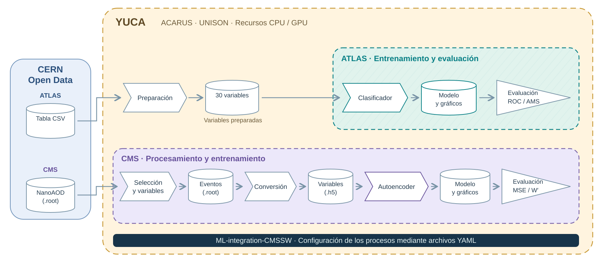

---
hide:
  - navigation
  - toc
---

XXI Mexican School on Particles and Fields

<strong>19–23 de octubre de 2026</strong> · Puebla, México

Edificio Carolino · Ciudad Universitaria 2

<a href="https://indico.nucleares.unam.mx/event/2675/overview">Información oficial del evento</a>

Taller práctico · Universidad de Sonora

# Practical Machine Learning for HEP Data Analysis

Análisis de datos abiertos de ATLAS y CMS con redes neuronales en Yuca.

Yuca · ACARUS / UNISON · CPU y GPU

[Acceso y preparación](preparacion.md){ .md-button .md-button--primary }
[Ejercicio ATLAS](atlas.md){ .md-button .hero-secondary }
[CMS](autoencoder.md){ .md-button .hero-secondary }

Física de partículas · Ciencia de datos · Supercómputo Ilustración conceptual generada con IA.

<a class="open-data-brand" href="https://opendata.cern.ch/" aria-label="Visitar el portal CERN Open Data">

Portal de datos abiertos
</a>

<h2>CERN Open Data</h2>

El portal reúne datos de experimentos de física de partículas, software y documentación para su análisis. Este acceso permite trabajar con muestras abiertas y reproducir estudios de procesos físicos.

En el taller utilizaremos simulaciones de <strong>ATLAS y CMS</strong> para recorrer las etapas del análisis, desde los datos de origen hasta la interpretación de los resultados.

<a href="https://opendata.cern.ch/">Explorar el portal oficial →</a>

Logotipo: CERN Open Data.

## El flujo de un análisis experimental

En el curso practicaremos las etapas de un análisis de física experimental de partículas: partir de una fuente de datos, procesarlos en un clúster, estudiar observables y extraer conclusiones. El entrenamiento de redes neuronales forma parte del recorrido de los dos ejercicios, con un énfasis diferente en cada uno.

### Arquitectura de los ejercicios {#aplicacion-a-los-ejercicios-del-curso}

El marco exterior representa **Yuca**. Dentro de él, el marco verde destaca el entrenamiento y la evaluación de **ATLAS**; el violeta incluye el procesamiento y el entrenamiento de **CMS**. Ambos utilizan el software **ML-integration-CMSSW**, con entradas de distinto formato procedentes de CERN Open Data.

## Datos, infraestructura y software de análisis

<h3>Yuca · Cómputo de alto rendimiento en la UNISON</h3>

El clúster Yuca, operado por el Área de Cómputo de Alto Rendimiento (ACARUS) de la Universidad de Sonora, aporta la infraestructura para procesar las muestras y entrenar los modelos del curso.

Un clúster reúne nodos de cómputo que permiten distribuir tareas. En un análisis de partículas, esto facilita procesar distintos archivos de eventos y comparar entrenamientos. Las CPU realizan tareas generales y las GPU pueden acelerar los cálculos de las redes neuronales.

<dl class="yuca-capacity">

<dt>24 nodos CPU</dt><dd>Procesamiento de datos</dd>

<dt>6 nodos GPU · MI210</dt><dd>Cómputo acelerado</dd>

<dt>36.77 TB de RAM</dt><dd>Memoria total publicada</dd>

<dt>3.25 PB</dt><dd>Almacenamiento HDD y SSD</dd>

</dl>

Capacidades globales publicadas por ACARUS. <a href="https://acarus.unison.mx/hardware/">Ficha oficial de hardware de Yuca</a>.

<figure>

<figcaption>Clúster Yuca. Fotografía: <a href="https://acarus.unison.mx/hardware/">ACARUS · Universidad de Sonora</a>.</figcaption>
</figure>

**[ML-integration-CMSSW](https://github.com/castaned/ML-integration-CMSSW)** reúne las herramientas de análisis que conectan los datos con los resultados: selección de eventos, construcción de variables y entrenamiento de modelos. Una configuración documentada permite repetir el análisis y estudiar el efecto de sus cambios.

Los ejercicios de ATLAS y CMS muestran cómo se combinan estos componentes para responder una pregunta física. Las redes neuronales forman parte de las herramientas disponibles; sus resultados deben interpretarse a partir del proceso estudiado y de las condiciones del análisis.

<strong>30</strong>variables para explorar

<strong>250 mil</strong>eventos para desarrollar el modelo

<strong>CPU ↔ GPU</strong>comparación de tiempos de entrenamiento

<strong>1 YAML</strong>por experimento; una carpeta por resultado

!!! info "Primer paso: preparar tu acceso y tu cuenta"
    La [preparación inicial en Yuca](preparacion.md) explica el primer SSH, la doble verificación, cómo trabajar desde Open OnDemand o JupyterLab y cómo solicitar recursos de ACARUS. Esta preparación es necesaria antes de iniciar los ejercicios.

## Dos ejercicios con CERN Open Data

Los dos ejercicios siguen el esquema anterior. En ATLAS comenzamos con variables ya calculadas; en CMS realizamos también la selección de eventos y la extracción de observables desde NanoAOD.

[Ejercicio 1: ATLAS Higgs Challenge](atlas.md){ .md-button .md-button--primary }
[Autoencoder CMS](autoencoder.md){ .md-button }

En ambos ejercicios se comienza reproduciendo una configuración de referencia. Sus conteos, figuras y métricas se revisan antes de introducir cambios; esa ejecución se conserva para comparar las variaciones.

## Programa del taller

### Miércoles · 3 horas

**Primeras dos horas: preparación y entrenamiento de referencia.** Acceso a Yuca, presentación de la física del Higgs Challenge y revisión de las variables. Ejecutaremos la misma red inicial y localizaremos sus figuras y métricas en las carpetas personales.

**Última hora: experimentación.** Cada estudiante o grupo modificará una configuración YAML, guardará la nueva ejecución en una carpeta diferente y comparará sus resultados con la referencia. Las variaciones se repartirán entre los grupos para estudiar distintos aspectos del entrenamiento.

### Jueves · 1 hora

**Comparación y discusión.** Reuniremos los resultados para analizar la separación entre señal y fondo, el sobreajuste y el tiempo de entrenamiento en CPU y GPU.

**CMS.** Revisaremos un segundo flujo que parte de eventos NanoAOD: selección, extracción de variables y entrenamiento de un autoencoder para explorar anomalías.

### Trabajo esperado

Cada estudiante o grupo deberá:

- Reproducir el entrenamiento de referencia y reconocer sus archivos de resultados.
- Probar al menos una variación del YAML, conservando la configuración y los resultados de ambas ejecuciones.
- Registrar las métricas y una figura representativa en la bitácora del ejercicio.
- Presentar una conclusión apoyada en los resultados: qué cambió, si hubo mejora y qué limitaciones tiene la comparación.

[Comenzar con el acceso y la preparación](preparacion.md){ .md-button .md-button--primary }

El código de entrenamiento y los YAML se mantienen en [ML-integration-CMSSW](https://github.com/castaned/ML-integration-CMSSW/tree/opendata_dev/workshop). Este sitio reúne el material docente. Cómputo en **ACARUS / Yuca, Universidad de Sonora**. Figuras publicadas y fuentes identificadas en el [capítulo de física](fisica.md#procedencia-de-las-imagenes).
