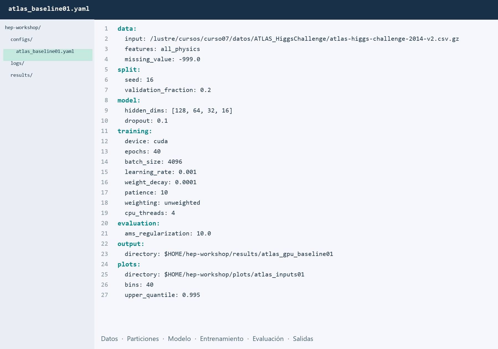

# ATLAS · Benchmark de referencia

Reproduce la configuración inicial y revisa sus resultados antes de probar variaciones del YAML.

## 1. Procesos y variables de entrada

En el menú izquierdo del taller, abre **ATLAS → Procesos y variables**. Allí encontrarás los diagramas del Higgs, las treinta variables y sus distribuciones. Revisa ese contenido en el navegador y después regresa a **Benchmark** para continuar.

[Revisar procesos y variables](fisica.md){ .md-button }

## 2. Red neuronal de referencia {#red-neuronal-de-referencia}

El benchmark del taller es una red completamente conectada de clasificación binaria. Esta configuración proporciona el punto de comparación para los ejercicios posteriores; no corresponde al modelo ganador del challenge.


Las cuatro capas ocultas utilizan activación ReLU y dropout. La salida se transforma mediante una función sigmoide en una puntuación entre cero y uno; los valores altos favorecen la clasificación como señal.

| Parámetro | Configuración de referencia |
| --- | --- |
| Variables de entrada | Las 30 variables físicas |
| Capas ocultas | `[128, 64, 32, 16]` |
| Dropout | `0.1` |
| Optimizador | AdamW |
| Tasa de aprendizaje | `0.001` |
| Tamaño de lote | `4096` eventos |
| Máximo de épocas | `40` |
| Parada temprana | `10` épocas sin mejora de la pérdida de validación |
| Entrenamiento / validación | 200 000 / 50 000 eventos, de la partición `t` |

Los valores ausentes se sustituyen por medianas y las variables se estandarizan. Ambas transformaciones se ajustan únicamente con los eventos de entrenamiento. El modelo conservado es el de menor pérdida de validación.

## 3. Reproducir el entrenamiento de referencia

Primero ejecutaremos todos la misma configuración. Los datos ya están compartidos en Yuca y cada cuenta guarda sus propios resultados.

!!! info "Preparar el YAML de referencia"
    Con el acceso y el ambiente GPU ya preparados, ejecutar desde la terminal:

    ```bash
    cd "$HOME/ML-integration-CMSSW"
    git pull --ff-only origin opendata_dev
    mkdir -p "$HOME/hep-workshop/configs" "$HOME/hep-workshop/logs"
    cp -n workshop/configs/atlas_higgs_gpu.yaml "$HOME/hep-workshop/configs/atlas_baseline01.yaml"
    ```

    Si falta configurar el ambiente, completar la [preparación inicial](preparacion.md#3-clonacion-y-preparacion-del-entorno-de-analisis). Para generar las comparaciones de las treinta variables, sigue el [apoyo de visualización](apoyo.md#3-mira-las-variables-antes-de-entrenar).

Si ya tenías una copia personal del YAML, actualiza `training.epochs` a `40` y `training.patience` a `10`; `cp -n` conserva los archivos existentes.

### Abrir y revisar el YAML en JupyterLab

1. En el **explorador de archivos de la izquierda**, vuelve a tu carpeta personal y abre **hep-workshop → configs**.
2. Haz doble clic en **atlas_baseline01.yaml** para abrirlo en el editor. Si no se abre como texto, haz clic derecho y selecciona **Open With → Editor**.
3. Revisa `model` (capas y dropout) y `training` (épocas, tamaño de lote y tasa de aprendizaje). Para reproducir la referencia, conserva los valores de la copia inicial.
4. Comprueba que `output.directory` coincida con la ruta siguiente. Si necesitas corregirla, edita el valor **después de los dos puntos**, conservando la sangría, y guarda con **Ctrl+S**.



Puedes conservar `output.directory` al repetir el entrenamiento. Cada envío crea una subcarpeta nueva: `run_0001`, `run_0002`, etc., sin sobrescribir las anteriores.

```yaml
output:
  directory: $HOME/hep-workshop/results/atlas_gpu_baseline01
```

### Enviar el benchmark

Guarda el YAML con **Ctrl+S**. En la terminal de JupyterLab, desde la raíz del repositorio, envía el trabajo:

El script del benchmark solicita **una GPU, cuatro CPU, 16 GB de memoria y hasta 30 minutos**, con el proyecto `curso07` y la QOS `qoscurso07`. Comprueba que tu cuenta tiene acceso a ese proyecto antes de enviarlo.

```bash
JOB_ID=$(sbatch --parsable --output="$HOME/hep-workshop/logs/atlas_%j.out" \
  workshop/run_atlas_gpu.slurm "$HOME/hep-workshop/configs/atlas_baseline01.yaml")
echo "Trabajo enviado: $JOB_ID"
```

### Seguir el entrenamiento en la terminal

Después de enviar el trabajo, ejecuta en la misma terminal:

```bash
python workshop/monitor_atlas.py \
  -f "$HOME/hep-workshop/configs/atlas_baseline01.yaml" \
  --job-id "$JOB_ID" \
  --log "$HOME/hep-workshop/logs/atlas_${JOB_ID}.out"
```

El visor muestra el **estado de Slurm**, una **barra de épocas**, las pérdidas y el AUC de validación. La gráfica de la terminal compara las pérdidas en una misma escala: **T** para entrenamiento y **V** para validación. Se actualiza con los valores reales de cada época completada.

Antes de la primera época, indica si el trabajo está en cola o activo y muestra las últimas líneas del log. Si el trabajo falla, muestra el estado y el registro para identificar el problema.

Al comenzar, verás un mensaje como este:

```text
Slurm: EN EJECUCIÓN | amdgpu-hpc-01
[------------------------------] Sin épocas registradas / máximo 40
Trabajo activo; aún no se ha completado la primera época.
Resultados: /lustre/home/TU_USUARIO/hep-workshop/results/atlas_gpu_baseline01/run_0001
```

Deja el visor abierto: después de la primera época aparecerán las pérdidas, el AUC y la gráfica. **Resultados** indica la carpeta de esta ejecución.

**Qué observar:** ¿disminuyen ambas pérdidas? ¿La validación deja de mejorar mientras entrenamiento sigue bajando? Al finalizar, el visor muestra la época del modelo conservado y la AMS interna. La parada temprana puede terminar antes de que la barra alcance el máximo.

Si el trabajo aún está en cola o prepara los datos, aparecerá un mensaje de espera. **Ctrl+C cierra solamente el visor**; el trabajo continúa en Slurm. Puedes volver a abrirlo con el mismo comando, incluso cuando la corrida haya terminado. Si abriste una nueva terminal, sustituye `${JOB_ID}` por el número del trabajo que se mostró al enviarlo.

Si el visor se cierra sin mostrar resultados finales o el avance se detiene, comprueba el estado con los comandos siguientes y revisa el log. Para consultar una sola captura del visor, añade `--once`. [Apoyo operativo](apoyo.md).

### Comprobar el estado del trabajo

```bash
squeue -u "$USER"
sacct -j "$JOB_ID" --format=JobID,State,ExitCode,Elapsed -X
```

En la cola, **PD** indica que espera recursos y **R** que está ejecutándose. Al terminar, `COMPLETED` con código `0:0` indica que finalizó sin error. No envíes otra copia mientras la primera espera. Si necesitas detener esa ejecución, utiliza `scancel "$JOB_ID"`. En una nueva terminal, sustituye `$JOB_ID` por el número recibido al enviar el trabajo.


## 4. Revisar los resultados del entrenamiento

En el explorador izquierdo de JupyterLab, abre la carpeta **Resultados** indicada por el visor, por ejemplo **hep-workshop → results → atlas_gpu_baseline01 → run_0001**. Abre las tres figuras y `metrics.json`.

### Pérdidas y aprendizaje

En **`training_loss.png`**, observa las dos curvas:

- **Pérdida de entrenamiento:** el error que la red intenta reducir al aprender.
- **Pérdida de validación:** el error sobre eventos que no se utilizan para ajustar sus parámetros. Es la curva que usamos para elegir el modelo.
- **Mejor época (`best_epoch`):** la época con menor pérdida de validación; su modelo queda guardado. **Épocas ejecutadas (`epochs_run`)** indica cuántas se completaron en total.

Si la pérdida de entrenamiento baja pero la de validación sube, puede haber **sobreajuste**. El máximo es 40 épocas; tras 10 sin mejora de validación, el entrenamiento se detiene.

### Separación entre señal y fondo {#leer-una-roc-como-fisico}

En **`classifier_scores.png`**, la puntuación va de 0 a 1: los valores altos favorecen señal. Observa cuánto se solapan las distribuciones de Higgs y fondo. Al exigir una puntuación mínima, seleccionas parte de ambas muestras.

En **`roc_curve.png`**, cada punto corresponde a un umbral distinto. El eje horizontal muestra la fracción de fondo aceptado y el vertical la fracción de señal conservada. Una curva más arriba conserva más señal para el mismo fondo; una más a la izquierda acepta menos fondo para la misma señal.

### Indicadores que debes registrar {#comparar-benchmark}

Los siguientes valores están en **`metrics.json`**:

| Indicador · campo del archivo | Qué significa y cómo compararlo |
| --- | --- |
| **AUC** · `roc_auc_unweighted` | Resume la separación en toda la ROC: 0.5 corresponde a una clasificación aleatoria y 1 a una separación perfecta. Un valor mayor indica mejor separación global, pero no garantiza mejor selección en la región de bajo fondo. |
| **AMS interna** · `ams_validation_tuned` | Sensibilidad aproximada de una selección, calculada con los rendimientos ponderados de señal y fondo. Mayor es mejor bajo las mismas condiciones de evaluación. No es una significancia observada. |
| **Umbral** · `threshold` | Puntuación mínima elegida para maximizar la AMS en validación. Determina qué eventos se aceptan; un umbral mayor no implica por sí solo una mejora. |
| **Eficiencia de señal** · `signal_efficiency` | Fracción de eventos de señal que supera ese umbral. Multiplica por 100 para expresarla como porcentaje. |
| **Aceptación de fondo** · `background_acceptance` | Fracción de eventos de fondo que supera el mismo umbral. Busca reducirla conservando señal. Estas dos fracciones son conteos sin pesos; la AMS sí utiliza pesos. |
| **Mejor época / épocas ejecutadas** · `best_epoch` / `epochs_run` | Cuándo se obtuvo el modelo conservado y cuánto duró el aprendizaje. Más épocas no garantizan mejor validación. |
| **Tiempo de entrenamiento** · `fit_seconds` | Segundos del entrenamiento, sin incluir la espera en cola. Permite valorar el costo de una mejora y comparar CPU/GPU con la misma configuración. |

### Qué significa una mejora {#interpretar-ams}

**AUC y AMS responden a preguntas distintas:** la AUC resume todos los umbrales; la AMS evalúa una selección concreta y sus rendimientos ponderados. Por eso pueden cambiar en sentidos diferentes.

<span id="significado-fisico"></span>
Una mejor separación puede ayudar a medir una señal con menor incertidumbre o aumentar la sensibilidad a procesos poco frecuentes. La conclusión física requiere también datos observados, normalizaciones e incertidumbres: **una AMS mayor no equivale a un descubrimiento**.

### Guardar la referencia y continuar

En la [bitácora](bitacora.md), selecciona **Referencia** y carga `metrics.json`: se completarán AUC, AMS, tiempo, épocas ejecutadas y mejor época. Descarga el CSV para la comparación. Conserva la subcarpeta de esta corrida y su `config.yaml`: será tu referencia para comparar variaciones con los mismos datos y particiones.

Las figuras están disponibles en PNG, PDF y SVG. Si necesitas regenerarlas sin volver a entrenar:

```bash
python workshop/plot_atlas_training.py --results "$HOME/hep-workshop/results/atlas_gpu_baseline01/run_0001"
```

Sustituye la ruta por la carpeta de tu corrida.

[Anterior: procesos y variables](fisica.md){ .md-button }
[Continuar: variaciones y resultados](variaciones.md){ .md-button .md-button--primary }
