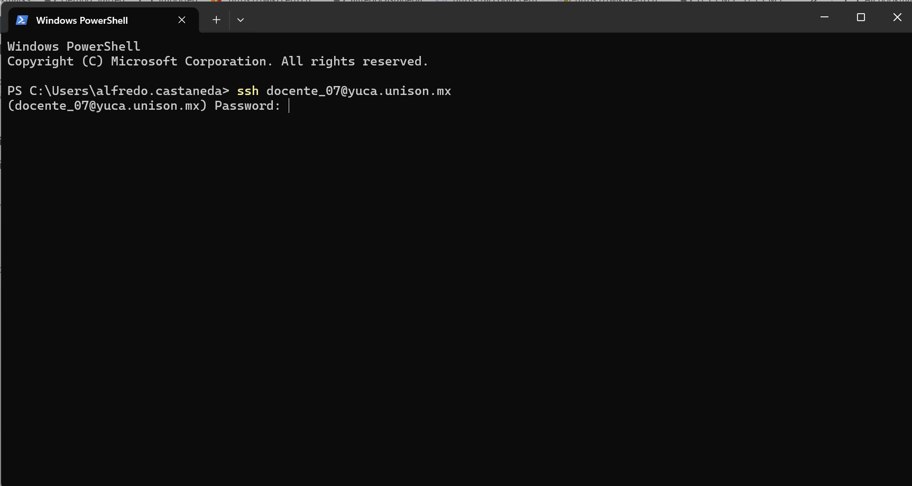
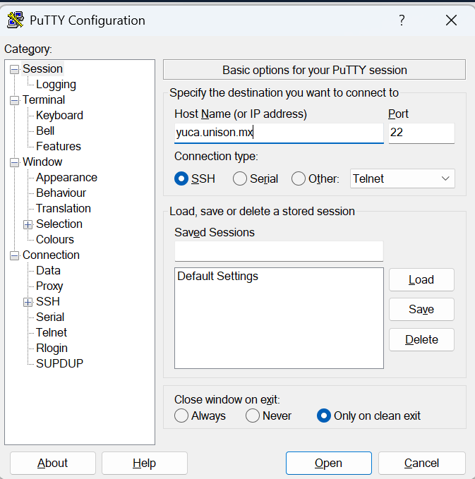
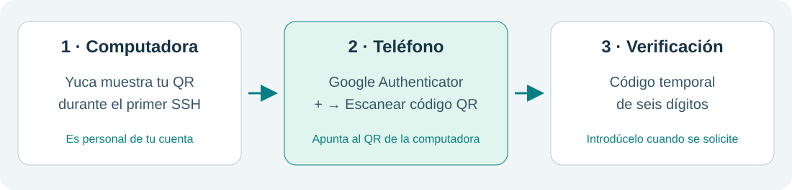
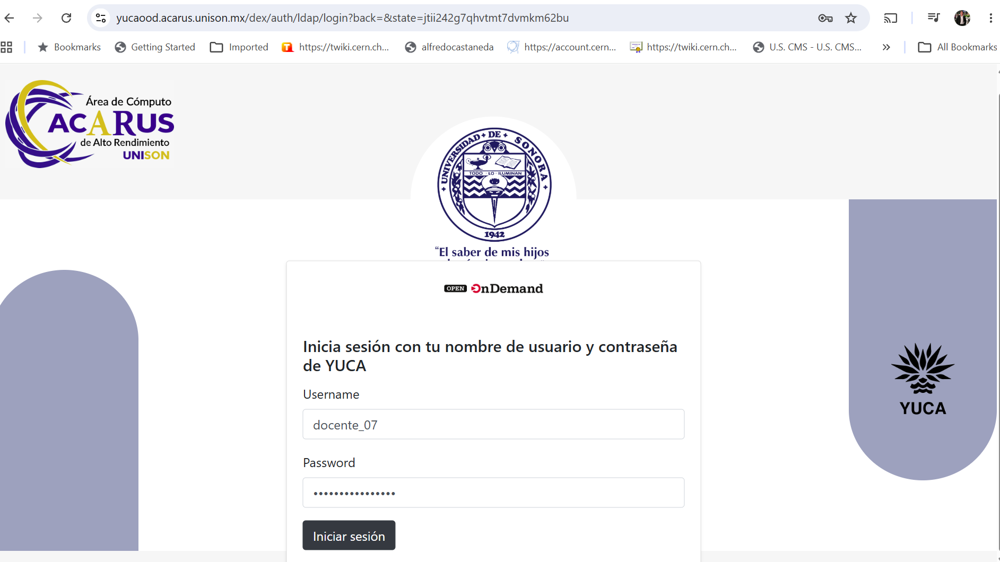
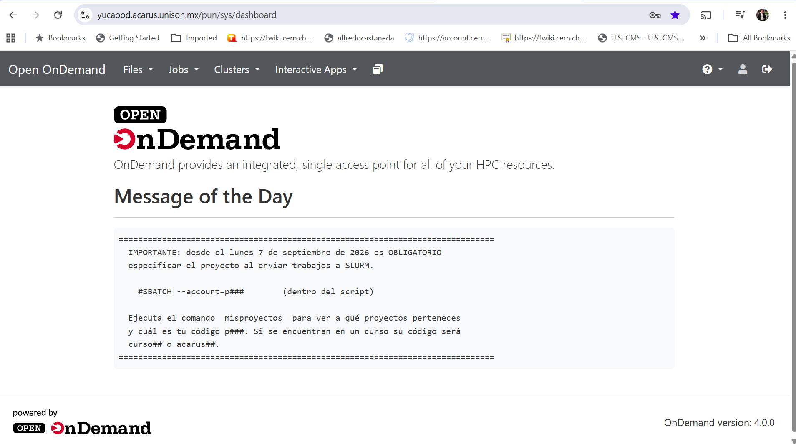
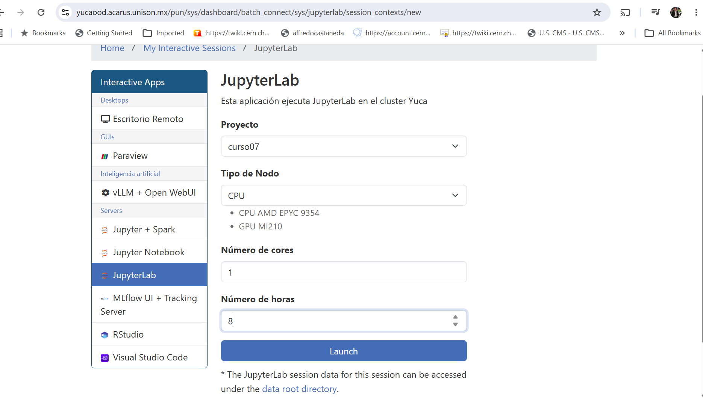
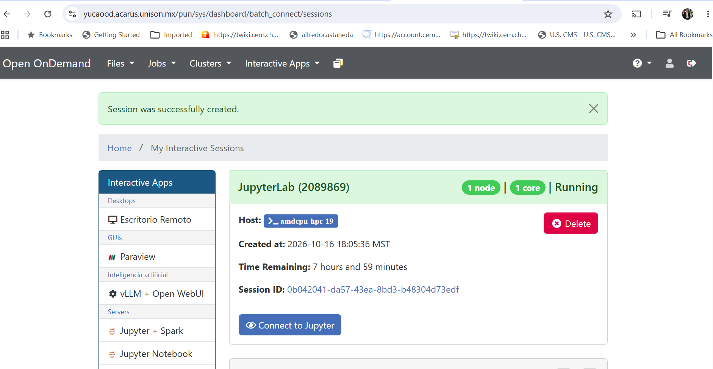
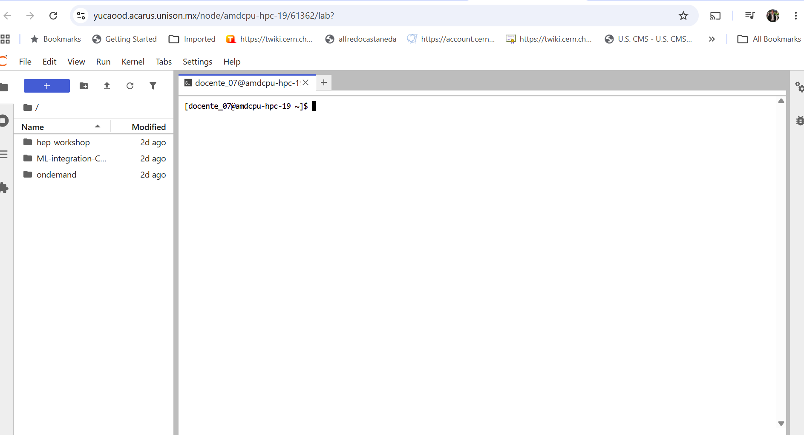

# Acceso y configuración del entorno en Yuca

Las prácticas se realizarán en **Yuca, el clúster de alto rendimiento de la Universidad de Sonora, operado por ACARUS**. En esta sección prepararás el acceso y el entorno para procesar los datos y entrenar las redes con el software [ML-integration-CMSSW](https://github.com/castaned/ML-integration-CMSSW).

<div class="grid cards" markdown>

- **Preparación inicial · Una sola vez**

    **Acceso:** cuenta de Yuca y doble verificación.

    **Herramienta:** copia del repositorio de análisis en tu cuenta.

    **Ambiente:** Python y las bibliotecas necesarias para los ejercicios.

- **Inicio de trabajo · Cada sesión**

    **Conexión:** Open OnDemand y terminal de JupyterLab.

    **Entorno:** activación del ambiente y acceso al repositorio de análisis.

- **Configuración y resultados · Cada experimento**

    **Configuración:** archivo YAML personal con los parámetros que vas a estudiar.

    **Resultados:** carpeta propia para conservar las figuras, métricas y modelos de cada ejecución.

</div>

## 1. Primer acceso: antes de Open OnDemand

La primera conexión se hace por **SSH desde tu computadora**. En ella se prepara tu directorio personal y se activa la doble verificación de la cuenta. Completa esta etapa antes de entrar a Open OnDemand.

### Paso 1. Conectarse a Yuca con la cuenta asignada

#### Windows · Opción preferida: PowerShell

Abre el menú Inicio, busca **PowerShell** y abre la aplicación. Ejecuta el siguiente comando, sustituyendo `TU_USUARIO` por el nombre de usuario que se te proporcionó para el curso:

```powershell
ssh TU_USUARIO@yuca.unison.mx
```

Cuando aparezca `Password:`, escribe **la contraseña que se te proporcionó para el curso** y pulsa **Enter**.



*La captura utiliza la cuenta de ejemplo `docente_07`. Debes escribir tu propio usuario asignado.*

#### Windows · Alternativa: PuTTY

Si no cuentas con PowerShell o el comando `ssh` no está disponible, **descarga e instala PuTTY** desde la [página oficial de descargas](https://www.chiark.greenend.org.uk/~sgtatham/putty/latest.html). Abre el programa y completa los campos como en la imagen:

- **Host Name:** `yuca.unison.mx`.
- **Port:** `22`.
- **Connection type:** `SSH`.

Pulsa **Open**. Cuando aparezca `login as:`, escribe **el nombre de usuario que se te proporcionó para el curso** y pulsa **Enter**. Después introduce la contraseña proporcionada cuando aparezca `Password:` y pulsa **Enter**.

{ width="580" }

#### Linux o macOS · Terminal del sistema

Abre la terminal del sistema y utiliza el mismo comando SSH, con tu usuario asignado:

```bash
ssh TU_USUARIO@yuca.unison.mx
```

Cuando aparezca `Password:`, escribe **la contraseña que se te proporcionó para el curso** y pulsa **Enter**.

En cualquiera de las terminales, la contraseña no se muestra mientras la escribes: no aparecen caracteres ni asteriscos. Es el comportamiento normal.

### Paso 2. Escanear el QR con Google Authenticator

Ten instalada **Google Authenticator en tu teléfono** antes de continuar. Durante la primera activación, Yuca mostrará un **código QR personal** en la terminal o indicará un enlace para visualizarlo.

1. Abre **Google Authenticator** en el teléfono.
2. Pulsa **+** para añadir una cuenta y selecciona **Escanear un código QR**.
3. Desde la app, apunta la cámara al **QR de tu cuenta de Yuca que aparece en la computadora**.
4. Comprueba que la cuenta quedó añadida y que la app muestra un código temporal de seis dígitos.

**El QR se escanea dentro de Google Authenticator.** Este registro vincula tu cuenta de Yuca con los códigos que genera la app.



*Esquema orientativo; no contiene un QR válido ni códigos de acceso reales.*

### Paso 3. Completar la activación

Continúa con las indicaciones de la terminal. Cuando solicite un código de verificación, escribe el código vigente de la cuenta de Yuca en Google Authenticator. Si cambia antes de introducirlo, utiliza el nuevo.

**Antes de seguir:** la cuenta debe aparecer en Authenticator y el proceso de activación en la terminal debe haber terminado. A partir de ese momento usarás tu contraseña y el código de la app cuando el sistema los solicite.

El QR y los códigos de recuperación, si se proporcionan, son personales: no los compartas ni los incluyas en capturas del curso. Si el QR no aparece o no puedes completar la activación, solicita apoyo antes de continuar.

[Ayuda oficial de Google Authenticator](https://support.google.com/accounts/answer/1066447?hl=es).

Con la activación completada, continúa con el acceso a **Open OnDemand** en la siguiente sección.

## 2. Terminales de Open OnDemand y JupyterLab

### Paso 1. Iniciar sesión en Open OnDemand

Abre **Open OnDemand de Yuca**: [https://yucaood.acarus.unison.mx/](https://yucaood.acarus.unison.mx/).

Introduce el nombre de usuario y la contraseña que se te proporcionaron para el curso. Completa la verificación con el código de Google Authenticator cuando se solicite.



### Paso 2. Seleccionar JupyterLab

En el panel principal, abrir **Interactive Apps** y seleccionar **JupyterLab**. 



### Paso 3. Solicitar la sesión interactiva

Completar el formulario y seleccionar **Launch**:

| Campo | Valor para la sesión del taller |
| --- | --- |
| Proyecto | `curso07` |
| Tipo de Nodo | `CPU` |
| Número de cores | `1` |
| Número de horas | `5` |

En **Número de horas**, introduce `5`, aunque la captura muestre `8`.



### Paso 4. Conectarse a JupyterLab

Esperar a que la sesión indique **Running** y seleccionar **Connect to Jupyter**. La asignación puede tardar según la disponibilidad de recursos. No es necesario crear otra sesión mientras la primera permanece en espera.



### Paso 5. Abrir la terminal

En JupyterLab, abrir **File → New → Terminal**, o utilizar **+** para abrir el Launcher y seleccionar **Terminal**. 



Mantén abierta esta terminal para ejecutar los comandos de las siguientes secciones.

## 3. Clonación y preparación del entorno de análisis

El repositorio principal [ML-integration-CMSSW](https://github.com/castaned/ML-integration-CMSSW/tree/opendata_dev) contiene el núcleo de los procesos y los scripts de Python de los dos ejercicios. Se clonará en la cuenta personal de Yuca. El repositorio de esta página contiene el material del curso.

| Ubicación | Contenido y uso |
| --- | --- |
| `$HOME/ML-integration-CMSSW` | Código de procesamiento, entrenamiento y scripts de ejecución |
| `$HOME/hep-workshop/configs` | Copias personales de los YAML que se editarán durante los ejercicios |
| Carpeta indicada en el YAML de cada proceso | Productos del análisis: datos procesados, figuras, métricas y modelos, según el paso ejecutado |

Para realizar una variación, copiar el YAML, editar los parámetros indicados y asignar una carpeta de salida nueva. Ejecutar después el comando correspondiente desde el repositorio principal. Los scripts de Python se conservan sin modificaciones durante los ejercicios.

### Clonación del repositorio · solo la primera vez

Ejecuta estos comandos **una sola vez en tu cuenta de Yuca** para descargar la herramienta y preparar tus carpetas personales:

```bash
cd "$HOME"
git clone --branch opendata_dev https://github.com/castaned/ML-integration-CMSSW.git
cd ML-integration-CMSSW
mkdir -p "$HOME/hep-workshop/configs" "$HOME/hep-workshop/logs"
```

Si ya clonaste el repositorio, entra a esa carpeta y actualiza con `git pull --ff-only origin opendata_dev`; no necesitas otra copia.

### Creación del ambiente de entrenamiento · solo la primera vez

Para las GPU AMD MI210 de Yuca usamos el ambiente personal `ml-hep-gpu`. **Créalo e instala sus paquetes una sola vez en tu cuenta** con estos comandos:

```bash
source /apps/miniconda3/etc/profile.d/conda.sh
module load rocm/6.4.3
conda create -n ml-hep-gpu python=3.10 pip -y
conda activate ml-hep-gpu
python -m pip install torch==2.8.0 --index-url https://download.pytorch.org/whl/rocm6.4
python -m pip install numpy pandas scikit-learn matplotlib pyyaml h5py
```

En las siguientes sesiones, utiliza los comandos de **Inicio de una sesión de trabajo**, más abajo: solo necesitas activar el ambiente y entrar al repositorio. Esta combinación de PyTorch y ROCm fue probada en una MI210 de Yuca. El ambiente de procesamiento CMS `ml-open-data`, si ya lo tienes, es independiente.

## 4. Inicio de una sesión de trabajo

Después de abrir una terminal en Yuca, ejecuta:

```bash
source /apps/miniconda3/etc/profile.d/conda.sh
module load rocm/6.4.3
conda activate ml-hep-gpu
cd "$HOME/ML-integration-CMSSW"
```

La terminal debe mostrar `(ml-hep-gpu)`. Ya puedes seguir el laboratorio con tu YAML.

Los datos originales estarán en la carpeta compartida:

```bash
ls -lh /lustre/cursos/curso07/datos/ATLAS_HiggsChallenge/
```

No necesitas descargarlos ni modificarlos. Tus YAML, registros y resultados se guardan en `hep-workshop` dentro de tu cuenta.

## 5. Uso de los recursos de ACARUS

Yuca administra los trabajos mediante Slurm. La arquitectura y los parámetros de entrenamiento se definen en el archivo YAML; el script del curso solicita los recursos de cómputo necesarios.

| Recurso o acción | Para qué lo usamos |
| --- | --- |
| CPU | Preparación y comparación de tiempos de entrenamiento |
| GPU AMD MI210 | Entrenamiento de redes neuronales |
| Proyecto o cuenta de Slurm | Identifica a qué proyecto se carga el trabajo |
| Cola | Esperar hasta que los recursos estén disponibles |
| Carpeta personal | Conservar la configuración y salida de cada experimento |

Consulta el proyecto autorizado para tu cuenta:

```bash
misproyectos
```

En las pruebas del curso se utiliza **`curso07`** y la QOS **`qoscurso07`**. Los scripts ya incluyen esos valores. Si tu cuenta no muestra ese proyecto, revísalo con el docente antes de enviar trabajos; no utilices el proyecto de otra persona.

Para el primer entrenamiento, con el YAML ya preparado en el [laboratorio](laboratorio.md):

```bash
sbatch --output="$HOME/hep-workshop/logs/atlas_%j.out" \
  workshop/run_atlas_gpu.slurm "$HOME/hep-workshop/configs/atlas_baseline01.yaml"
```

El script solicita **una GPU, cuatro CPU, 16 GB de memoria y hasta 30 minutos**. No hace falta editar el script para variar la arquitectura de la red.

### Seguimiento de los trabajos

```bash
squeue -u "$USER"
```

- **PD:** está esperando recursos.
- **R:** está ejecutándose.
- Si desapareció, consulta su registro para verificar si terminó correctamente.

Sustituye `NUMERO_JOB` por el número que devolvió `sbatch`:

```bash
tail -30 "$HOME/hep-workshop/logs/atlas_NUMERO_JOB.out"
sacct -j NUMERO_JOB --format=JobID,State,ExitCode,Elapsed -X
```

`COMPLETED` con código `0:0` indica que terminó sin error. No es necesario enviar otra copia mientras la primera espera. Si necesitas cancelar una prueba, usa `scancel NUMERO_JOB` solo para el trabajo que deseas detener.

## Verificación del entorno

<ul class="environment-checks">
<li>Puedo entrar a Yuca y abrir una terminal.</li>
<li>Mi terminal muestra <code>(ml-hep-gpu)</code> y estoy en <code>ML-integration-CMSSW</code>.</li>
<li>Puedo ver el archivo compartido del challenge.</li>
<li>Mi cuenta tiene el proyecto del curso y entiendo cómo consultar un trabajo.</li>
</ul>

[Continuar: entender la física](fisica.md){ .md-button .md-button--primary }

Los detalles generales de la herramienta permanecen en su [manual técnico](https://castaned.github.io/ML-integration-CMSSW/). Este capítulo reúne los pasos necesarios para empezar la práctica en ACARUS.

