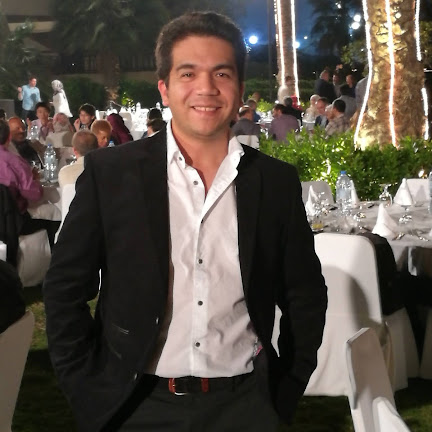

# Recursos y contacto

## Herramientas de análisis

**Código y configuraciones · ML-integration-CMSSW**  
[https://github.com/castaned/ML-integration-CMSSW/tree/opendata_dev](https://github.com/castaned/ML-integration-CMSSW/tree/opendata_dev)

Procesamiento de eventos, extracción de variables y entrenamiento de redes neuronales mediante archivos YAML.

**Documentación de la herramienta**  
[https://castaned.github.io/ML-integration-CMSSW/](https://castaned.github.io/ML-integration-CMSSW/)

Procedimientos técnicos y ejemplos de uso.

**CERN Open Data**  
[https://opendata.cern.ch/](https://opendata.cern.ch/)

Datos y simulaciones públicos para explorar nuevos análisis.

## Cómputo en la Universidad de Sonora

El taller utiliza **Yuca**, el clúster de alto rendimiento de **ACARUS / UNISON**, para el procesamiento de muestras y el entrenamiento en CPU y GPU.

Agradecemos al **Área de Cómputo de Alto Rendimiento (ACARUS) de la Universidad de Sonora** el apoyo y los recursos de cómputo utilizados en el desarrollo de los análisis y en este taller.

**Cuentas y acceso a recursos de cómputo:** para solicitar información sobre cuentas, requisitos de acceso o apoyo técnico, consulta los canales de atención publicados por ACARUS.

**ACARUS:** [https://acarus.unison.mx/](https://acarus.unison.mx/)  
**Universidad de Sonora:** [https://www.unison.mx/](https://www.unison.mx/)

- [Infraestructura y características de Yuca](https://acarus.unison.mx/hardware/).
- [Acceso a Open OnDemand](https://yucaood.acarus.unison.mx/).
- [Activación de cuenta y acceso a Yuca](preparacion.md).

## Acerca del instructor

{ width="240" }

**Dr. Alfredo Castañeda Hernández**  
Departamento de Investigación en Física · Universidad de Sonora

El Dr. Alfredo Castañeda Hernández es Profesor-Investigador del Departamento de Investigación en Física de la Universidad de Sonora y miembro del Sistema Nacional de Investigadoras e Investigadores (SNII), Nivel I. Es especialista en física experimental de partículas y ha desarrollado su trabajo científico en experimentos del Gran Colisionador de Hadrones (LHC) del CERN, participando en las colaboraciones ATLAS y CMS.

Es miembro fundador del grupo UNISON-CMS, establecido a partir de la incorporación de la Universidad de Sonora a la colaboración CMS en 2018. Sus líneas de investigación se enfocan en búsquedas de nueva física más allá del Modelo Estándar, análisis de datos y desarrollo de detectores.

También trabaja en la aplicación de métodos computacionales, estadísticos y de aprendizaje automático en física de altas energías, y en la formación de estudiantes que participan en proyectos de investigación relacionados con CMS y CERN.

[Consultar el perfil institucional](https://buhos-api.unison.mx/PureXML/Investigador/Index/33989-ALFREDO%20MARTIN%20CASTA%C3%91EDA%20HERNANDEZ).

## Consultas y colaboración

**Correo institucional:** [alfredo.castaneda@unison.mx](mailto:alfredo.castaneda@unison.mx)

Las consultas son bienvenidas durante y después del taller. Puedes escribir para comentar una idea de análisis, explorar aplicaciones del aprendizaje automático o conversar sobre tus intereses en física de partículas.

Podemos discutir cómo adaptar el flujo del curso a otras muestras y observables, cómo organizar el procesamiento y cómo evaluar los resultados de una red neuronal. Al escribir, comparte brevemente tu objetivo, las muestras que te interesan y el punto en el que necesitas orientación.

Semblanza y fotografía proporcionadas por el instructor. Correo institucional consultado en el [perfil institucional de UNISON](https://buhos-api.unison.mx/PureXML/Investigador/Index/33989-ALFREDO%20MARTIN%20CASTA%C3%91EDA%20HERNANDEZ).

